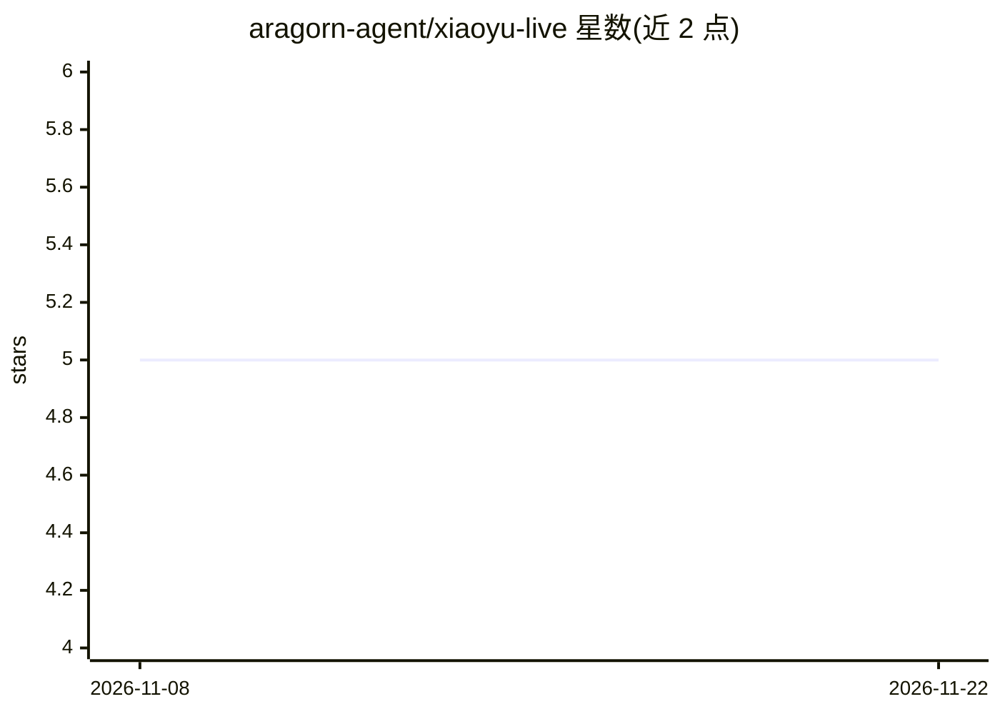

# aragorn-agent/xiaoyu-live

⭐ 5 · Python · NOASSERTION · 推送 2026-11-04 · [GitHub](https://github.com/aragorn-agent/xiaoyu-live) · 个人维护 · 中文 README

**给抖音主播搭建一个可 7×24 运行的 AI 虚拟主播直播间**

一套纯 Python 主栈加静态前端的 AI 虚拟主播系统：接入抖音直播间弹幕/点赞/礼物/进场五类事件，喂给带人设卡、情绪引擎与记忆系统的 LLM 大脑生成回复，经 edge-tts/GPT-SoVITS/CosyVoice 三级降级合成语音，配合三态绿幕虚拟形象与点赞喂饭特效渲染成网页舞台，通过直播伴侣浏览器图层开播。安装需 Python 3.12，六个纯 Python 依赖，无编译与 GPU 要求；弹幕接入走 CDP 只读旁观，README 提示存在账号风控风险。

## 筛选速览

| 维度 | 判定 | 备注 |
|---|---|---|
| AI 角色 | `ai-native` | 本体是模型或模型工具 |
| 许可风险 | `permissive` | NOASSERTION |
| 部署形态 | `library` | 以包/库形式分发 |
| 模型依赖 | — | README 未给出锁定关系 |
| 硬件要求 | — | 无带数字的原话,不猜 |
| 安装摩擦 | `low` | 无编译、无系统依赖或容器化 |
| 成熟度 | — | 结构信号不足 |

## 能力要点

- LLM 三级降级路由：本地快车道→云端中转→官方 API
- 人设卡+情绪引擎+显式触发记忆的对话大脑
- edge-tts/GPT-SoVITS/CosyVoice 语音三级降级，字幕逐句同步
- WebGL 双轨绿幕合成，无需 OBS 抠像插件

## 适用场景

- 给自己的抖音直播间挂一个会回复弹幕的 AI 主播
- 不开播时用 Mock 源本地演示完整弹幕回复流程
- 用豆包图生视频生成素材替换自定义虚拟形象

## 场景标签

`聊天机器人` `语音合成` `视频生成` · 领域:对话与助手

## 证据(README 行号)

> L28: 一个**把 AI 装进直播间**的完整开源系统：抖音直播间的弹幕、点赞、礼物、进场，全部实时喂给一个有记忆、有情绪、有人设的 AI 大脑；AI 的回复通过 TTS 说出来，配合三态绿幕虚拟形象（待机/说话/开心）+ 桌面玻璃碗点赞
> L133: 大脑走 **OpenAI 兼容协议**，任何一家中转/官方 API 都能接，支持三级降级路由（`config/config.yaml`）：
> L111: ### ① 装 Python 3.12（勾选 Add to PATH）

## 星数曲线

2026-11-08 5 → 2026-11-22 5（+0）

---
*卡片 v1 · prompt 1.4 · 生成 2026-11-21 · 置信度 high · 依据 README sha `e4416bff4468` · [字段定义](../../DATASET.md)*
