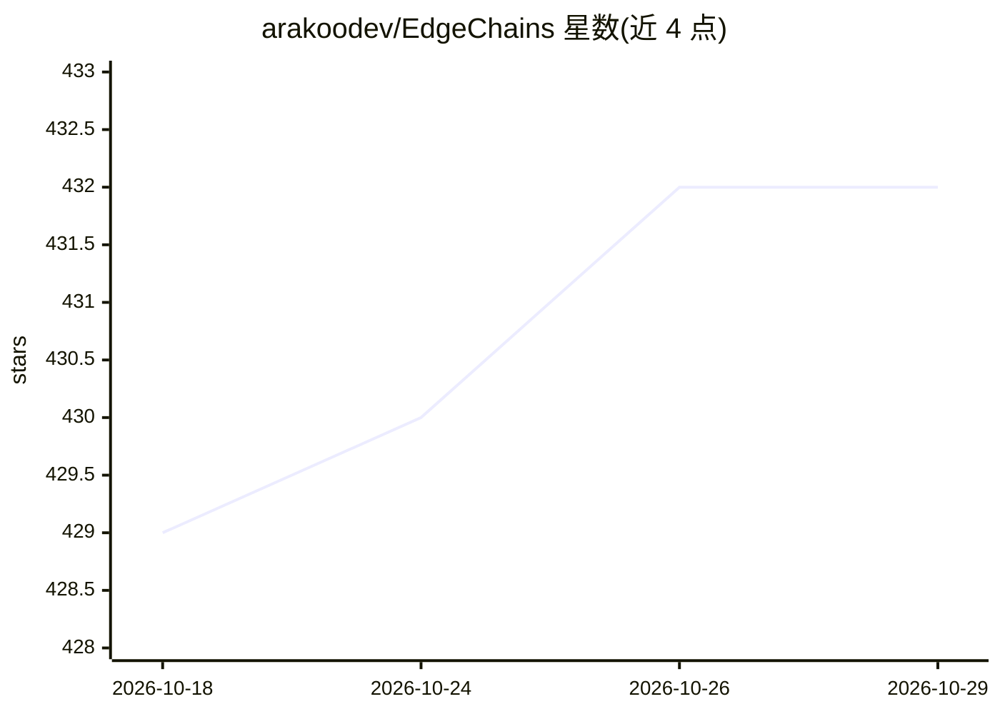

# arakoodev/EdgeChains

⭐ 432 · JavaScript · AGPL-3.0 · 推送 2026-10-26 · [GitHub](https://github.com/arakoodev/EdgeChains) · [官网](https://www.arakoo.ai/) · 组织维护

**基于 jsonnet 声明式管理提示词与链的全栈 GenAI 框架**

面向开发者的 JavaScript 全栈生成式 AI 库：将提示词与链逻辑以 jsonnet 声明式文件管理（可置于 S3 或 API），而非隐藏在类与抽象层中，以解决提示爆炸、提示漂移与生产测试问题。构建于 honojs 与 jsonnet 之上，支持自动并行化 LLM 链任务、故障重试回退、细粒度 token 成本追踪。安装方式为 git clone 源码 + npm 安装依赖，示例 ChatWithPdf 需配置 Supabase PostgreSQL 向量库。

## 筛选速览

| 维度 | 判定 | 备注 |
|---|---|---|
| AI 角色 | `ai-ecosystem` | LLM/agent 周边工具 |
| 许可风险 | `viral` | AGPL-3.0 |
| 部署形态 | `library` | 以包/库形式分发 |
| 模型依赖 | — | README 未给出锁定关系 |
| 硬件要求 | — | 无带数字的原话,不猜 |
| 安装摩擦 | `low` | 无编译、无系统依赖或容器化 |
| 成熟度 | — | 结构信号不足 |

## 能力要点

- 提示词与链以 jsonnet 声明式管理，可版本化与 diff，可存放于 S3/API
- 基于 WebAssembly 运行时在 CPU/GPU/TPU 上自动并行化链任务
- 内置故障重试与退避机制
- 内置 token 成本的细粒度追踪与测量

## 适用场景

- 用声明式配置管理大量针对不同 LLM 的提示词并跟踪其漂移
- 在生产环境中持续测试和迭代提示词与链
- 搭建并运行 ChatWithPdf 类文档问答应用

## 场景标签

`提示工程` `RAG` `文档问答` · 领域:Agent 开发

## 证据(README 行号)

> L15: At EdgeChains, we take a unique approach to Generative AI - we think Generative AI is a deployment and configuratio
> L21: * **Versioning for Prompts**: Prompts are written in jsonnet. Makes them easily versionable and diffable.
> L22: * **Automatic parallelism**: EdgeChains automatically parallelizes LLM chains & chain-of-thought tasks across CPUs,

## 星数曲线

2026-10-18 429 → 2026-10-29 432（+3）

---
*卡片 v1 · prompt 1.4 · 生成 2026-10-21 · 置信度 high · 依据 README sha `d9b8dc8bbbd0` · [字段定义](../../DATASET.md)*
