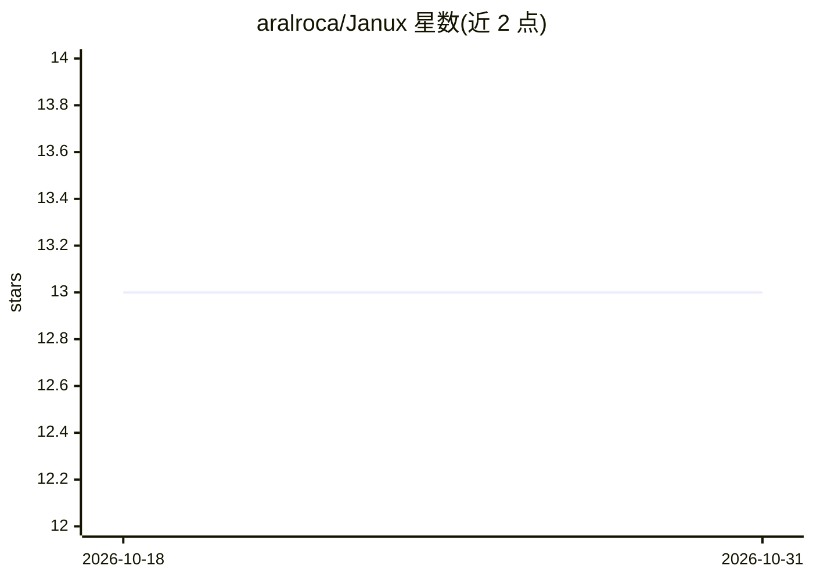

# aralroca/Janux

⭐ 13 · TypeScript · MIT · 推送 2026-10-17 · [GitHub](https://github.com/aralroca/Janux) · [官网](https://janux.build) · 个人维护

**全栈框架：一份组件定义同时产出人类 UI 与 AI agent 的 MCP 工具**

面向 JavaScript/TypeScript 开发者的 Agentic Web 全栈框架：一个组件定义被投影为视图、typed JSON 资源与 MCP 工具三种形态，人类点击与 agent 工具调用进入同一管线（guard 检查 → schema 校验 → run() → 审计记录）。内置 MCP/A2A/WebMCP/llms.txt/Web Bot Auth 协议支持，提供 confirm/auto/forbidden 三级 guard 与人工审批（Proposal）机制，附 copilot（支持 Anthropic/OpenAI/Google/OpenRouter）与 janux verify/eval CLI。用 Bun 脚手架安装，生产可跑 Bun/Node 24+/Vercel/静态导出。自述处于活跃开发期，未正式发布，可能有破坏性变更与未完成功能。

## 筛选速览

| 维度 | 判定 | 备注 |
|---|---|---|
| AI 角色 | `ai-ecosystem` | LLM/agent 周边工具 |
| 许可风险 | `permissive` | MIT |
| 部署形态 | `None` |  |
| 模型依赖 | locked-api |  |
| 硬件要求 | — | 无带数字的原话,不猜 |
| 安装摩擦 | `low` | 无编译、无系统依赖或容器化 |
| 成熟度 | `idea` | |

## 能力要点

- 一份组件定义生成视图、资源、工具三种投影，UI 与 agent 面不漂移
- 开箱支持 MCP、A2A、WebMCP、llms.txt、Web Bot Auth 协议
- guard 语言级声明（auto/confirm/forbidden）与人工审批 Proposal 机制
- janux verify/eval 对 agent 面做 CI 校验与脚本化评测

## 适用场景

- 让 Web 应用同时被人类与 MCP agent 操作，避免二次工具开发
- 为 agent 可调用的敏感操作设置人工审批
- 通过静态导出把站点发布为 agent 可读可操作页面

## 场景标签

`Agent 框架` · 领域:Agent 开发

## 证据(README 行号)

> L6:  One component, two faces: a live view for humans, typed MCP tools &amp; resources for AI agents — generated from th
> L91: |**MCP** — tools over HTTP|A real, stateless MCP server at `/_janux/mcp`, generated from your `api()` functions. Du

## 星数曲线

2026-10-18 13 → 2026-10-31 13（+0）

---
*卡片 v1 · prompt 1.4 · 生成 2026-10-31 · 置信度 high · 依据 README sha `8e52373346a3` · [字段定义](../../DATASET.md)*
