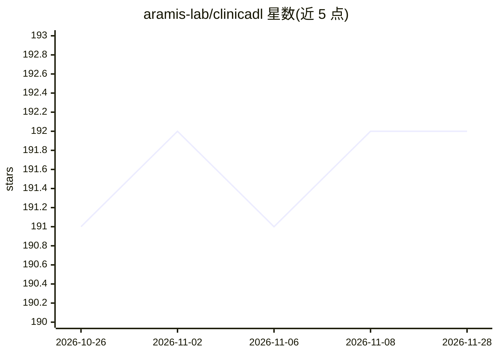

# aramis-lab/clinicadl

⭐ 192 · Python · MIT · 推送 2026-11-20 · [GitHub](https://github.com/aramis-lab/clinicadl) · [官网](https://clinicadl.readthedocs.io/en/stable/) · 组织维护

**神经影像研究的可复现深度学习 Python 库**

ClinicaDL 是一个用于构建神经影像研究端到端可复现深度学习流水线的 Python 库。它读取遵循 BIDS 标准的数据或 Clinica 预处理输出，依赖 MONAI 和 TorchIO 医学影像框架实现底层功能。项目提供在线文档与 Quickstart 入门指引，论文发表于 Computer Methods and Programs in Biomedicine（2021）。安装方式为 PyPI 包，安装细节见文档的安装指南。

## 筛选速览

| 维度 | 判定 | 备注 |
|---|---|---|
| AI 角色 | `ai-native` | 本体是模型或模型工具 |
| 许可风险 | `permissive` | MIT |
| 部署形态 | `library` | 以包/库形式分发 |
| 模型依赖 | — | README 未给出锁定关系 |
| 硬件要求 | — | 无带数字的原话,不猜 |
| 安装摩擦 | `low` | 无编译、无系统依赖或容器化 |
| 成熟度 | — | 结构信号不足 |

## 能力要点

- 构建神经影像研究端到端可复现深度学习流水线
- 支持 BIDS 标准数据与 Clinica 预处理输出
- 基于 MONAI 与 TorchIO 医学影像框架
- MIT 许可证发布

## 适用场景

- 对 BIDS 格式神经影像数据训练深度学习模型
- 复现已发表的神经影像深度学习分析流程
- 结合 Clinica 预处理结果开展后续建模

## 场景标签

`科研工具` `模型训练` · 领域:学习与行业

## 证据(README 行号)

> L9:  Open-source Python library for reproducible deep learning in neuroimaging
> L32: ClinicaDL is a Python library to build end-to-end reproducible deep learning pipelines for neuroimaging studies. It
> L34: It relies on the medical imaging frameworks MONAI and TorchIO.

## 星数曲线

2026-10-26 191 → 2026-11-28 192（+1）

---
*卡片 v1 · prompt 1.4 · 生成 2026-11-26 · 置信度 high · 依据 README sha `200bf972461d` · [字段定义](../../DATASET.md)*
