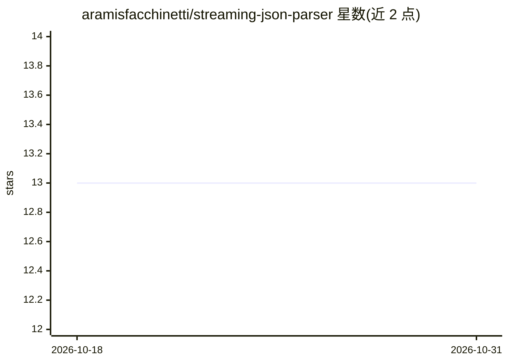

# aramisfacchinetti/streaming-json-parser

⭐ 13 · Python · MIT · 推送 2026-10-19 · [GitHub](https://github.com/aramisfacchinetti/streaming-json-parser) · [官网](https://pypi.org/project/streaming-json-parser/) · 个人维护

**Python 严格增量 JSON 流式解析库，支持 NDJSON 与选择性提取**

面向 Python 开发者的 JSON 处理库：提供严格增量流式解析（区分 EMPTY/PARTIAL/COMPLETE/INVALID 状态、部分值可在流到达前读取）、完整文档解码、NDJSON 解码与结构化部分快照，以及按路径的选择性提取。可选安装 Rust 扩展（streaming-json-parser-native）与 msgspec/orjson/simdjson 后端加速，纯 Python 实现无需可选依赖即可运行。项目自述处于 beta 阶段，公共 API 尚在稳定过程中。README 附带可复现的基准测试流程。

## 筛选速览

| 维度 | 判定 | 备注 |
|---|---|---|
| AI 角色 | `ai-enhanced` | 去掉 AI 部分产品仍成立 |
| 许可风险 | `permissive` | MIT |
| 部署形态 | `library` | 以包/库形式分发 |
| 模型依赖 | — | README 未给出锁定关系 |
| 硬件要求 | — | 无带数字的原话,不猜 |
| 安装摩擦 | `low` | 无编译、无系统依赖或容器化 |
| 成熟度 | `idea` | |

## 能力要点

- 严格增量解析，跨任意分块可恢复，含显式解析状态与部分值
- NDJSON 流式记录与按路径选择性提取（不构建完整 Python 对象）
- 可选 Rust 加速扩展与 msgspec/orjson/simdjson 后端，缺失时回退纯 Python
- 附带可复现的基准测试快照与验证流程

## 适用场景

- LLM 流式输出到达时边收边解析 JSON
- 处理 NDJSON 日志/数据流并提取指定字段
- 对不完整 JSON 前缀获取已完成对象的结构化快照

## 场景标签

 · 领域:数据处理/解析库

## 证据(README 行号)

> L3: **Decode complete JSON documents or parse JSON as chunks arrive.** `streaming-json-parser` provides a strict increme
> L36: The Python implementation works without optional packages. The project is currently in beta while its public API se

## 星数曲线

2026-10-18 13 → 2026-10-31 13（+0）

---
*卡片 v1 · prompt 1.4 · 生成 2026-10-31 · 置信度 mid · 依据 README sha `a4934e63dda0` · [字段定义](../../DATASET.md)*
