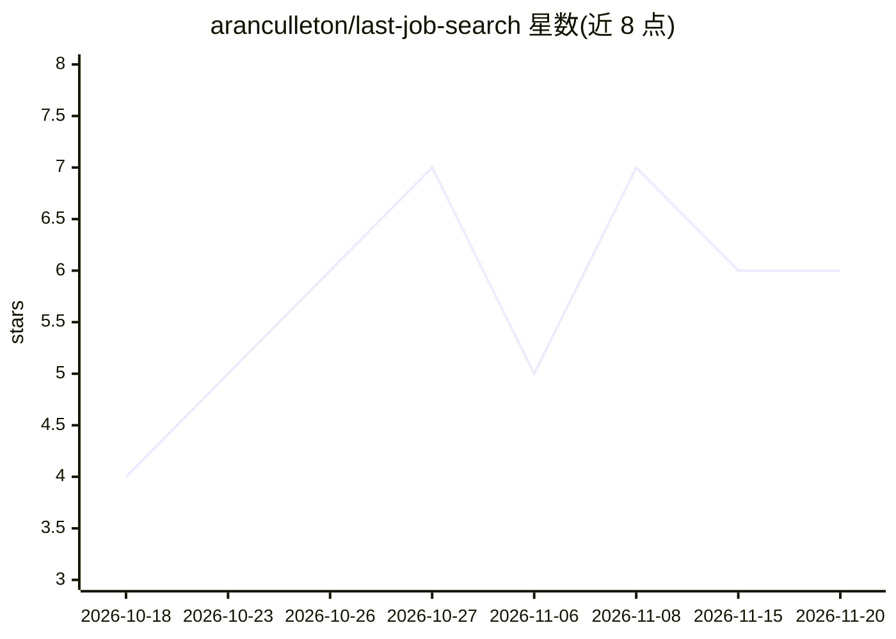

# aranculleton/last-job-search

⭐ 6 · Python · MIT · 推送 2026-11-19 · [GitHub](https://github.com/aranculleton/last-job-search) · 个人维护

**运行在 Claude Code 上的求职代理系统：找岗位、定制简历、跟进提醒**

基于 Claude Code 构建的求职代理系统：按用户背景对岗位打分（0-100 并给出理由）、为选定岗位生成并自检简历与求职信、在 LinkedIn 上寻找值得联系的人并起草首条消息、生成待办与跟进提醒、提供面试问答准备。全部状态保存在用户私有仓库副本的一个页面上，代理在后台聊天会话中执行任务；岗位搜索与打分为纯 Python 实现，不消耗模型调用。需要 GitHub 账号与付费 Claude 契约，手机即可使用，无需本地安装；读取 LinkedIn 简历需桌面端。

## 筛选速览

| 维度 | 判定 | 备注 |
|---|---|---|
| AI 角色 | `ai-native` | 本体是模型或模型工具 |
| 许可风险 | `permissive` | MIT |
| 部署形态 | `None` |  |
| 模型依赖 | locked-api |  |
| 硬件要求 | — | 无带数字的原话,不猜 |
| 安装摩擦 | `low` | 无编译、无系统依赖或容器化 |
| 成熟度 | — | 结构信号不足 |

## 能力要点

- 岗位按用户背景打分 0-100 并给出理由，缺技能仅降分不直接淘汰
- 为选定岗位生成简历与求职信，并按 ATS 读取方式回读自检
- 基于 LinkedIn 的联系人发现与跟进提醒，多后台聊天会话分工运行
- 数据全部留在用户私有仓库副本中，岗位文本按数据处理而非指令

## 适用场景

- 持续追踪匹配的新岗位并了解每条岗位的匹配/缺口原因
- 为特定职位定制简历和求职信，并通过自检降低格式风险
- 管理求职联系人并按时收到跟进草稿提醒
- 面试前生成可能问题与回答准备

## 场景标签

`AI 助手` `工作流自动化` `AI 写作` · 领域:效率与自动化

## 证据(README 行号)

> L3: **The last job search tool you'll ever need.** Claude finds jobs that fit you and scores each
> L17: - A GitHub account (free) and a paid Claude plan. Nothing to install: a phone is enough.
> L112: Searching and scoring are plain Python, so thousands of postings cost no model time. The

## 星数曲线

2026-10-18 4 → 2026-11-20 6（+2）

---
*卡片 v1 · prompt 1.4 · 生成 2026-11-20 · 置信度 high · 依据 README sha `313e48b8efc7` · [字段定义](../../DATASET.md)*
