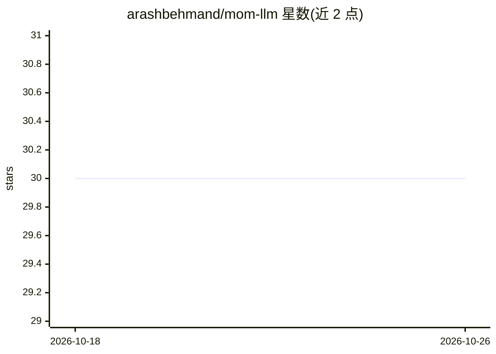

# arashbehmand/mom-llm

⭐ 30 · Python · MIT · 推送 2026-10-15 · [GitHub](https://github.com/arashbehmand/mom-llm) · 个人维护

**自托管 LLM 网关：多模型并行应答并合成一个回答**

MoM（Mixture of Models）是一个 Python 3.12+ 的自托管 LLM 网关，兼容 OpenAI 与 Anthropic 线协议。它将单个请求扇出到多个成员模型并行作答，再由指定的合成模型读取全部候选回答，输出一份合并响应（含文本与工具调用）。同一管线渲染 Chat Completions、Responses 与 Anthropic Messages 三种接口，另提供 MCP 工具面（默认关闭）。功能包括多模态视觉请求、按 reasoning_effort 分层、成本追踪、SQLite 响应缓存与用量表、提示缓存注入。通过 pip、Docker 或 docker compose 部署，配置以 YAML 定义模型面板，支持 <<SYSTEM>> 指令临时调整面板成员。

## 筛选速览

| 维度 | 判定 | 备注 |
|---|---|---|
| AI 角色 | `ai-ecosystem` | LLM/agent 周边工具 |
| 许可风险 | `permissive` | MIT |
| 部署形态 | `self-host` | docker 或自建部署 |
| 模型依赖 | locked-api |  |
| 硬件要求 | — | 无带数字的原话,不猜 |
| 安装摩擦 | `low` | 无编译、无系统依赖或容器化 |
| 成熟度 | — | 结构信号不足 |

## 能力要点

- fan-out/fan-in 架构：多模型并行作答，合成模型产出最终响应
- 三种协议接口（Chat Completions/Responses/Anthropic Messages）共用单一事件流管线
- MCP 工具面：consult 等工具将面板作为工具调用暴露（默认关闭）
- 成本追踪（litellm 成本表/OpenRouter 返回值）与 WAL SQLite 响应缓存

## 适用场景

- 把 Claude Code/Codex/Cursor 等客户端指向 MoM，无改动获得多模型合成回答
- 为编码或研究任务配置任务专属的模型面板（YAML 热切换）
- 通过 MCP 让 agent 在会话中以工具调用方式征求第二意见

## 场景标签

`模型网关` · 领域:Agent 开发

## 证据(README 行号)

> L10: MoM is a self-hosted LLM gateway that speaks the OpenAI and Anthropic wire protocols but answers
> L11: each request with a *panel* of models instead of one. It fans a single request out to several models
> L17: than any one model produces alone. Because MoM is drop-in wire-compatible, any tool that already

## 星数曲线

2026-10-18 30 → 2026-10-26 30（+0）

---
*卡片 v1 · prompt 1.4 · 生成 2026-10-26 · 置信度 high · 依据 README sha `f8c99e6eab21` · [字段定义](../../DATASET.md)*
