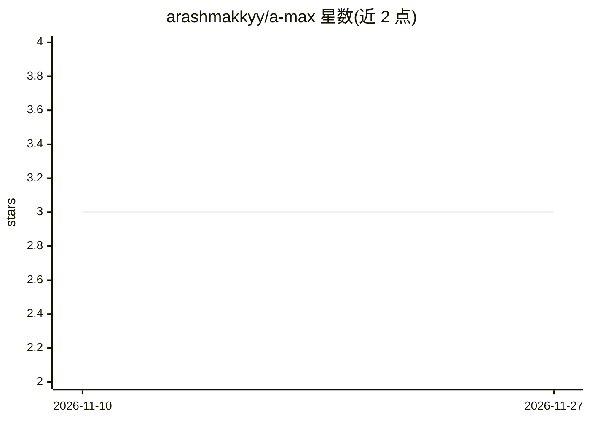

# arashmakkyy/a-max

⭐ 3 · JavaScript · MIT · 推送 2026-11-09 · [GitHub](https://github.com/arashmakkyy/a-max) · 个人维护

**面向 AI 聊天用户的浏览器扩展：导出对话与恢复草稿**

一个本地优先的 Chrome/Edge 浏览器扩展，为 20 个 AI 聊天站点（ChatGPT、Claude、Gemini、DeepSeek、Qwen、Grok、Perplexity、Kimi、Poe、Copilot 等）提供对话导出与辅助功能：每条回复旁添加导出按钮，支持 PDF、Word(.docx)、Markdown、PNG、JSON、TXT、HTML、CSV 八种格式；保留 prompt 草稿并按会话 ID 关联到所属对话；修复波斯语/RTL 文本显示。数据存储在 chrome.storage.local，无账号、无后端、无遥测。作者声明当前为可安装的开发版本而非正式发布，部分真实站点验证尚未完成。

## 筛选速览

| 维度 | 判定 | 备注 |
|---|---|---|
| AI 角色 | `ai-native` | 本体是模型或模型工具 |
| 许可风险 | `permissive` | MIT |
| 部署形态 | `desktop` | 安装包/桌面程序 |
| 模型依赖 | — | README 未给出锁定关系 |
| 硬件要求 | — | 无带数字的原话,不猜 |
| 安装摩擦 | `low` | 无编译、无系统依赖或容器化 |
| 成熟度 | `idea` | |

## 能力要点

- 8 种导出格式，PDF 经打印生成且可搜索
- 完整会话抓取：调用站点认证 API 获取完整消息树，失败时回退页面解析
- Prompt Guard 草稿按会话/标签页隔离，防止互相覆盖
- 本地优先存储于 chrome.storage.local，无账号与后端

## 适用场景

- 把与 ChatGPT/Claude 等的对话归档为 PDF 或 Word 文件
- 找回被打断或关闭标签页前的 prompt 草稿
- 在 AI 聊天窗口中修复波斯语 RTL 文本显示

## 场景标签

`知识库管理` · 领域:知识与检索

## 证据(README 行号)

> L12: A.max is an open-source, local-first browser extension for people who live in AI chat windows. It
> L15: Persian/RTL text on ChatGPT, Claude, Gemini, DeepSeek, Qwen, Grok, Perplexity, Kimi, Poe, Copilot and
> L21: > **Release status:** installable development build, not a verified public-production release.

## 星数曲线

2026-11-10 3 → 2026-11-27 3（+0）

---
*卡片 v1 · prompt 1.4 · 生成 2026-11-22 · 置信度 low · 依据 README sha `7a3ab7de3306` · [字段定义](../../DATASET.md)*
