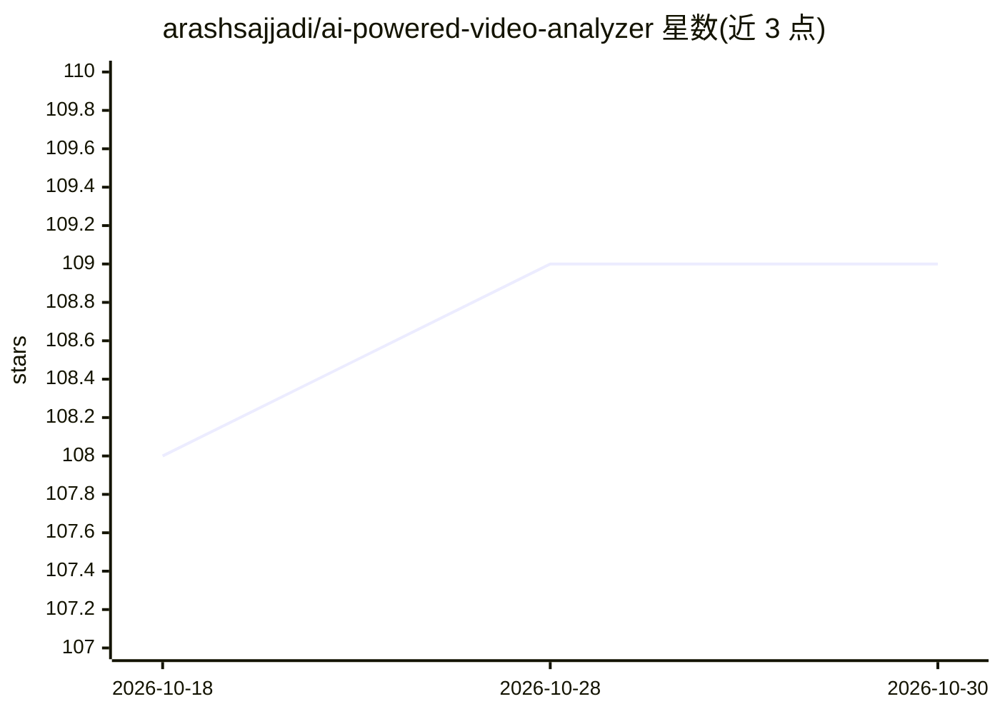

# arashsajjadi/ai-powered-video-analyzer

⭐ 109 · Python · 推送 2026-06-14 · [GitHub](https://github.com/arashsajjadi/ai-powered-video-analyzer) · 个人维护

**本地离线视频 AI 分析工具：检测、字幕、转录与摘要**

在本地机器上对视频文件运行多阶段 AI 流水线：VisionServeX D-FINE 目标检测（必选后端），可选 BLIP 图像描述、Whisper 语音转录、PANNs 音频事件检测，以及经 Ollama 本地模型生成的证据约束摘要。全程不联网上传，输出 JSON/Markdown 结构化报告。提供 CLI、doctor 依赖检查命令与保留的 Tkinter GUI；已知限制为 COCO-80 类别不含火、烟、天气等类别。

## 筛选速览

| 维度 | 判定 | 备注 |
|---|---|---|
| AI 角色 | `ai-native` | 本体是模型或模型工具 |
| 许可风险 | `permissive` | — |
| 部署形态 | `library` | 以包/库形式分发 |
| 模型依赖 | local-ok | 支持本地模型 |
| 硬件要求 | — | 无带数字的原话,不猜 |
| 安装摩擦 | `medium` | 含编译或系统依赖之一 |
| 成熟度 | — | 结构信号不足 |

## 能力要点

- D-FINE 目标检测为默认后端，含 fast/balanced/quality 等预设
- 可选 BLIP 描述、Whisper 转录、PANNs 音频事件检测与 Ollama 摘要
- ai-video-analyzer doctor 检查必选与可选依赖
- 输出 JSON 与 Markdown 结构化报告，区分观察事实与解释

## 适用场景

- 对本地视频做目标检测并生成结构化报告
- 离线转录视频语音与识别音频事件
- 在不上传云端的前提下获得视频内容的 AI 摘要

## 场景标签

`语音识别` `目标检测` `图像视频处理` · 领域:感知与多模态

## 证据(README 行号)

> L14: |Object detection|VisionServeX D-FINE|Required — primary backend|
> L16: |Scene captioning|BLIP (Salesforce)|Optional — needs `[full]`|
> L19: |LLM summarization|Ollama (any local model)|Optional — needs Ollama|

## 星数曲线

2026-10-18 108 → 2026-10-30 109（+1）

---
*卡片 v1 · prompt 1.4 · 生成 2026-10-23 · 置信度 high · 依据 README sha `db7a27678a25` · [字段定义](../../DATASET.md)*
