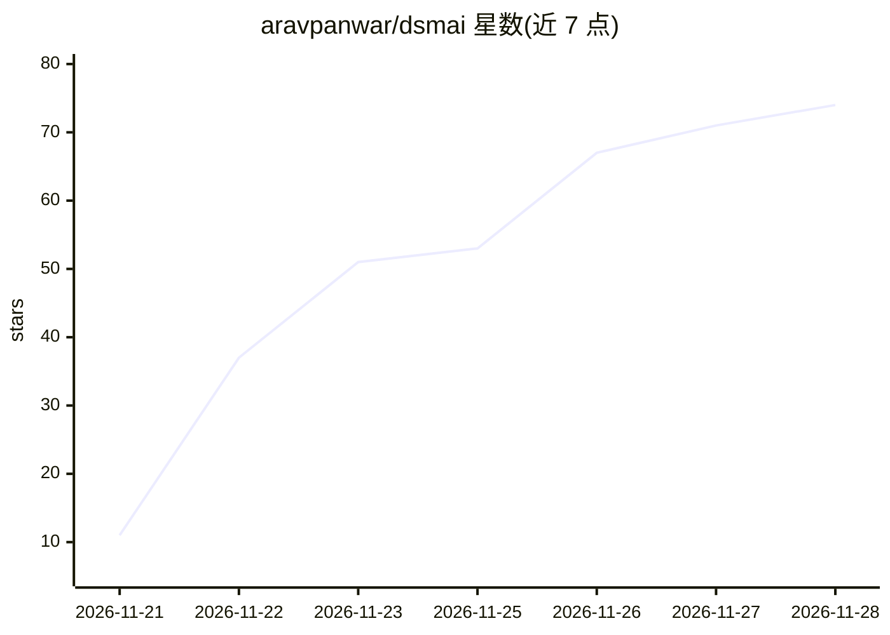

# aravpanwar/dsmai

⭐ 74 · JavaScript · MIT · 推送 2026-11-20 · [GitHub](https://github.com/aravpanwar/dsmai) · [官网](https://dsmai.aravpanwar.com/) · 个人维护

**现代 AI 概念依赖结构的交互式分层学习地图**

以知识图谱形式呈现现代 AI 的概念依赖：301 个概念、827 条依赖边，分八层从数学延伸到应用（如矩阵乘法到聊天助手的路径）。提供搜索、悬停追踪、路径对比、时间线与学习清单（勾选状态存于浏览器）。纯静态站点，无构建步骤，可用任意静态服务器本地运行；数据存于 data.js，附校验脚本；代码 MIT 许可，提供 DOI 与引用文件。

## 筛选速览

| 维度 | 判定 | 备注 |
|---|---|---|
| AI 角色 | `ai-knowledge` | 知识聚合/清单类 |
| 许可风险 | `permissive` | MIT |
| 部署形态 | `None` |  |
| 模型依赖 | — | README 未给出锁定关系 |
| 硬件要求 | — | 无带数字的原话,不猜 |
| 安装摩擦 | `low` | 无编译、无系统依赖或容器化 |
| 成熟度 | — | 结构信号不足 |

## 能力要点

- 301 个概念、827 条依赖边、八层结构
- Study list 学习清单带浏览器内保存的勾选进度
- URL 锚点直达概念/路径/学习清单，支持主题切换与 iframe 嵌入
- 无构建步骤，任意静态服务器即可运行

## 适用场景

- 按依赖顺序制定 AI 主题的学习计划
- 查找某个概念（如 attention）的上游数学与计算基础
- 课堂或文章中嵌入交互式 AI 概念地图

## 场景标签

`教程课程` · 领域:学习与行业

## 证据(README 行号)

> L5: A learning reference for modern AI. Pick any concept, from linear algebra to chat assistants, and see what it is bui
> L19: - Study list: open a concept and choose "Study list" to get everything under it in the order to learn it, with chec

## 星数曲线

2026-11-21 11 → 2026-11-28 74（+63）

---
*卡片 v1 · prompt 1.4 · 生成 2026-11-21 · 置信度 high · 依据 README sha `c287810825dc` · [字段定义](../../DATASET.md)*
