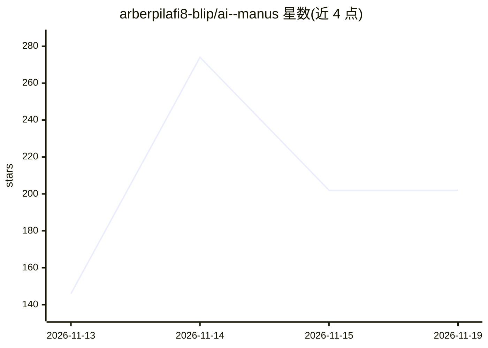

# arberpilafi8-blip/ai--manus

⭐ 202 · Apache-2.0 · 推送 2026-11-14 · [GitHub](https://github.com/arberpilafi8-blip/ai--manus) · 个人维护

**面向个人用户的自主 AI Agent：代跑代码与控制浏览器**

README 以宣传性文字描述一个名为 Manus 的自主 AI Agent：接收指令后代为编写并执行脚本、控制浏览器（导航页面、填写表单、采集信息），支持多步任务与跨会话保持行为模式，定位为家庭、学习与轻量办公场景的个人助手，非企业平台。给出 4 GB RAM 最低等硬件兼容表与六步上手说明，但全文未提供任何安装命令、下载链接、代码仓库结构或技术实现细节，且出现 'PROMO2026' 等推广用语，实际可用性无法从 README 验证。

## 筛选速览

| 维度 | 判定 | 备注 |
|---|---|---|
| AI 角色 | `ai-native` | 本体是模型或模型工具 |
| 许可风险 | `permissive` | Apache-2.0 |
| 部署形态 | `None` |  |
| 模型依赖 | — | README 未给出锁定关系 |
| 硬件要求 | — | 无带数字的原话,不猜 |
| 安装摩擦 | `low` | 无编译、无系统依赖或容器化 |
| 成熟度 | — | 结构信号不足 |

## 能力要点

- 自主执行代码与控制浏览器（导航、填表、采集信息）
- 支持多步任务与跨会话重复执行既定流程
- 脚本与浏览器动作可在同一任务流中衔接

## 适用场景

- 让代理代为完成重复的网页查询与表单填写
- 整理研究笔记、运行小脚本等学习类任务
- 远程支持场景中代查系统页面与整理诊断步骤

## 场景标签

`AI 助手` `浏览器自动化` `编码 Agent` · 领域:效率与自动化

## 证据(README 行号)

> L10: - **Autonomous Code Execution:** Manus AI agent runs code on its own to complete tasks, so you can focus on decisio
> L18: Manus is an autonomous AI agent designed to run code and control a browser on your behalf. Instead of acting like a

## 星数曲线

2026-11-13 146 → 2026-11-19 202（+56）

---
*卡片 v1 · prompt 1.4 · 生成 2026-11-17 · 置信度 low · 依据 README sha `4347b4dd3fa7` · [字段定义](../../DATASET.md)*
