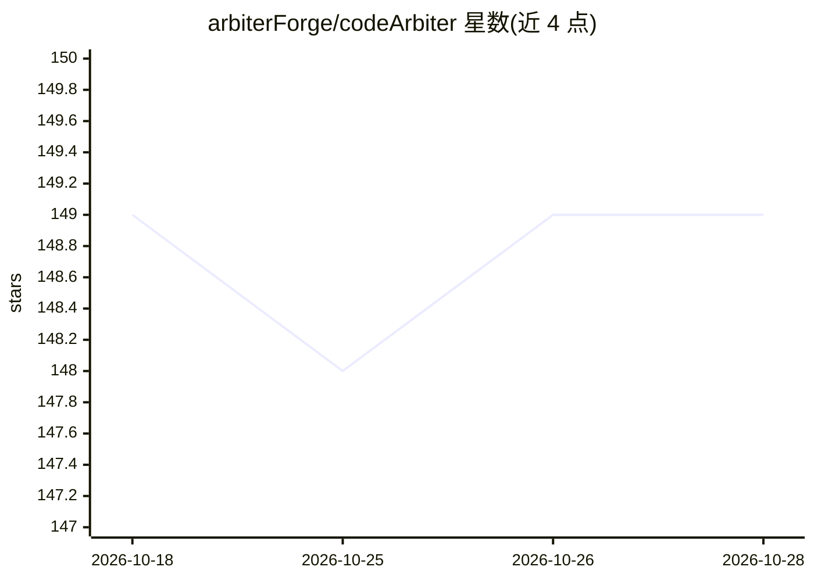

# arbiterForge/codeArbiter

⭐ 149 · Python · AGPL-3.0 · 推送 2026-10-28 · [GitHub](https://github.com/arbiterForge/codeArbiter) · [官网](https://codearbiter.dev/) · 组织维护

**面向 AI 编码 agent 的仓库级治理与硬门禁插件套件**

codeArbiter 是由仓库持有的治理层，为 Claude Code、Codex CLI 和 Pi 三类编码 agent 宿主提供四个兄弟插件（ca、ca-codex、ca-pi、ca-sandbox）。每个请求进入命名通道（lane），通道定义须产出的证据、须派发的评审与停止条件；硬门禁包括测试先行、红套件禁止提交、CONFIRM 问题不得猜测解决、禁止直接写默认分支等。治理状态存储于 .codearbiter/ 目录，可跨宿主迁移；全局安装后在仓库显式启用前保持休眠。前置要求包括 PATH 上的 Python 3、git user.email，Pi 需 Node.js 22.19+。ca-pi 为 Feature Forge preview 阶段。

## 筛选速览

| 维度 | 判定 | 备注 |
|---|---|---|
| AI 角色 | `ai-ecosystem` | LLM/agent 周边工具 |
| 许可风险 | `viral` | AGPL-3.0 |
| 部署形态 | `None` |  |
| 模型依赖 | — | README 未给出锁定关系 |
| 硬件要求 | — | 无带数字的原话,不猜 |
| 安装摩擦 | `low` | 无编译、无系统依赖或容器化 |
| 成熟度 | `idea` | |

## 能力要点

- 三宿主适配器（Claude Code/Codex CLI/Pi）共享一个 .codearbiter/ 项目存储，可跨宿主迁移
- 硬门禁：测试先行、红套件禁止提交、CONFIRM 禁猜、禁写默认分支与 force-push
- SMARTS 六维评估给出 strong/moderate/tied 建议，决策记录写入 sprint-log 并带置信标记
- 激活显式且按仓库生效，未启用时全局安装休眠

## 适用场景

- 团队让编码 agent 承担重要工作时强制测试先行与评审门禁
- 保留 ADR、决策与审计历史的可追溯 agent 工作流
- 在不同编码宿主间迁移而不丢失治理状态

## 场景标签

 · 领域:AI 编码工具/治理

## 证据(README 行号)

> L3: **Open-source governance and hard gates for AI coding agents across Claude Code, Codex CLI, and Pi.**
> L33: - `ca` for Claude Code, `ca-codex` for Codex CLI, and `ca-pi` for Pi are the three governance hosts.

## 星数曲线

2026-10-18 149 → 2026-10-28 149（+0）

---
*卡片 v1 · prompt 1.4 · 生成 2026-10-22 · 置信度 high · 依据 README sha `d96d927e0b40` · [字段定义](../../DATASET.md)*
