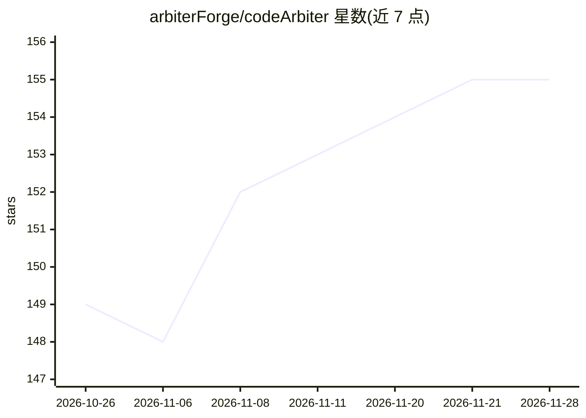

# arbiterForge/codeArbiter

⭐ 155 · Python · AGPL-3.0 · 推送 2026-11-27 · [GitHub](https://github.com/arbiterForge/codeArbiter) · [官网](https://codearbiter.dev/) · 组织维护

**给 AI 编码代理加治理硬门的仓库级插件层**

面向让编码代理承担重要工作的团队与重度用户，提供仓库级治理层：每个请求进入命名 lane，lane 定义必须产生的证据、分派的审查者与停止条件。硬门包括：无失败测试不写功能代码、红测试套件禁止提交、不猜测解决确认问题、默认分支无直写与强推。支持 Claude Code、Codex CLI、Pi 三个宿主，共享一个 `.codearbiter/` 项目存储，激活须由仓库显式 opt-in，全局安装默认休眠。许可证为 AGPL v3。

## 筛选速览

| 维度 | 判定 | 备注 |
|---|---|---|
| AI 角色 | `ai-ecosystem` | LLM/agent 周边工具 |
| 许可风险 | `viral` | AGPL-3.0 |
| 部署形态 | `None` |  |
| 模型依赖 | — | README 未给出锁定关系 |
| 硬件要求 | — | 无带数字的原话,不猜 |
| 安装摩擦 | `low` | 无编译、无系统依赖或容器化 |
| 成熟度 | — | 结构信号不足 |

## 能力要点

- 三宿主适配器（ca/ca-codex/ca-pi）从同一共享面生成，可在宿主间迁移项目记录
- 硬门清单：测试先行、commit gate、密钥不入库、默认分支保护等可强制执行约束
- 按工作量分 lane：prose 编辑走小 docs lane，安全敏感特性走完整 spec/test/review/PR 路径
- 操作留痕：`.codearbiter/` 存储 spec、ADR、任务与审计历史，doctor 做健康探针

## 适用场景

- 让 Claude Code/Codex 执行重要改动时强制测试先行的流程
- 对代理提交默认分支、绕过审查等行为设置硬性拦截
- 团队需要可审计的代理操作记录与决策留痕

## 场景标签

`编码 Agent` `代码审查` · 领域:编码与开发

## 证据(README 行号)

> L3: **Open-source governance and hard gates for AI coding agents across Claude Code, Codex CLI, and Pi.**
> L237: Activation is explicit and per repository. Claude Code and Codex check
> L27: codeArbiter is for teams and power users who let coding agents do consequential work and need more

## 星数曲线

2026-10-26 149 → 2026-11-28 155（+6）

---
*卡片 v1 · prompt 1.4 · 生成 2026-11-27 · 置信度 high · 依据 README sha `cdc3df22e64b` · [字段定义](../../DATASET.md)*
