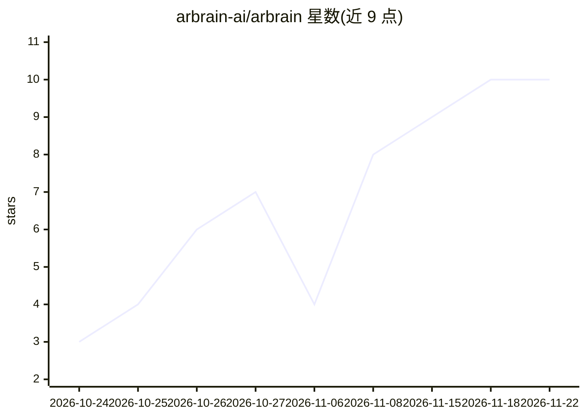

# arbrain-ai/arbrain

⭐ 10 · TypeScript · Apache-2.0 · 推送 2026-11-21 · [GitHub](https://github.com/arbrain-ai/arbrain) · [官网](https://arbrain.ai) · 个人维护

**个人 AI 二脑：Agent 帮你定目标、排计划并执行复盘**

基于 Claude Code 的个人智能体应用：用户说出目标，Agent Levy 生成月/周/日计划，负责排程、执行、复盘与调整，学习内容以 Markdown 文件写入本地记忆，全部数据存于用户磁盘并用 git 版本管理。功能含记忆、技能、日程与习惯、语音输入、白板画布、文件浏览器面板，以及经用户授权操作本机与网页的「Manos」。本地仅监听 127.0.0.1，需 Claude Pro/Max 账户或自备 API key。

## 筛选速览

| 维度 | 判定 | 备注 |
|---|---|---|
| AI 角色 | `ai-native` | 本体是模型或模型工具 |
| 许可风险 | `permissive` | Apache-2.0 |
| 部署形态 | `None` |  |
| 模型依赖 | locked-api |  |
| 硬件要求 | — | 无带数字的原话,不猜 |
| 安装摩擦 | `low` | 无编译、无系统依赖或容器化 |
| 成熟度 | — | 结构信号不足 |

## 能力要点

- 月/周/日计划生成与执行-复盘循环
- 记忆、技能、日程均为本地 Markdown 文件并用 git 版本管理
- 语音输入（Groq 免费密钥）与白板画布编辑
- 本地默认仅监听 127.0.0.1，遥控计算机功能默认关闭

## 适用场景

- 让 Agent 把目标拆成日程并每日跟进执行情况
- 把对个人业务的知识沉淀为本地可备份的记忆文件
- 用语音口述任务并让 Agent 代为操作电脑

## 场景标签

`知识库管理` `AI 助手` · 领域:对话与助手

## 证据(README 行号)

> L13: **Arbrain es tu cerebro artificial: un bucle hacia tu meta.** Le dices a dónde quieres llegar y tu agente, **Levy**
> L24: - **Lo de abajo es tuyo.** Tu memoria, tus habilidades y tus rutinas son archivos de texto en tu disco, versionados
> L62: Python, sin pedirte comandos. **Lo único que necesitas es una cuenta de Claude Pro o Max:** Claude Code, que hace l

## 星数曲线

2026-10-24 3 → 2026-11-22 10（+7）

---
*卡片 v1 · prompt 1.4 · 生成 2026-11-20 · 置信度 high · 依据 README sha `f20a74874656` · [字段定义](../../DATASET.md)*
