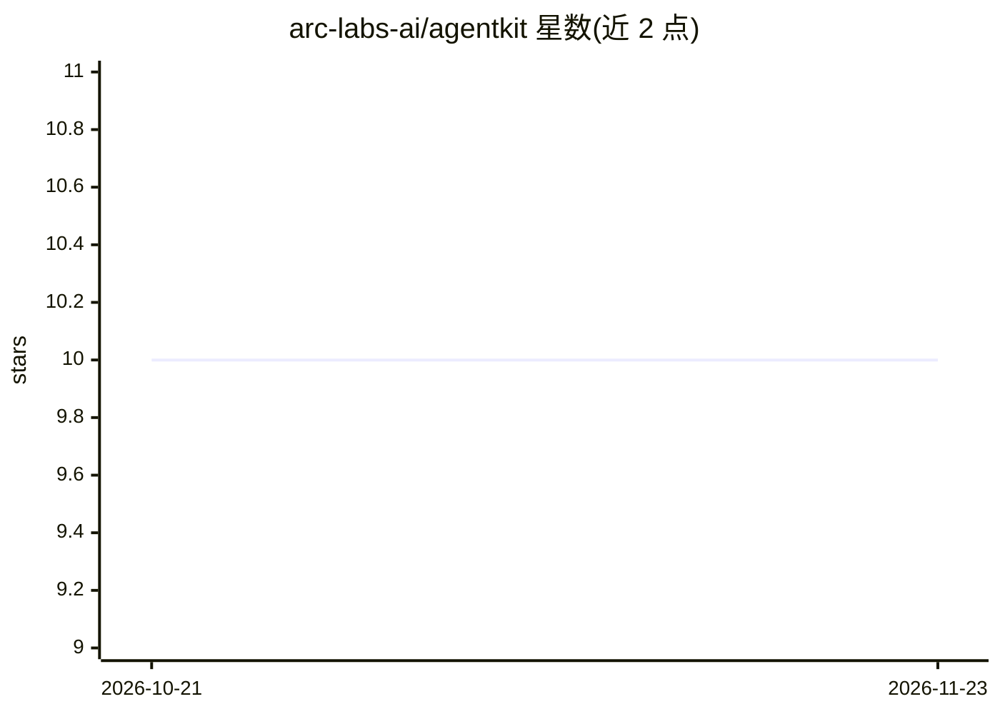

# arc-labs-ai/agentkit

⭐ 10 · Python · Apache-2.0 · 推送 2026-11-12 · [GitHub](https://github.com/arc-labs-ai/agentkit) · [官网](https://arc-labs-ai.github.io/agentkit/) · 组织维护

**构建 Python AI Agent 的低层异步框架：运行时+中间件原语**

agentkit 是面向 Python 3.12+ 的 AI Agent 构建框架，核心是单一执行运行时 CallRuntime（负责重试、限额、定价、结构化输出、续跑与调用事件），AgentRunner 在其上承载 Agent 定义、提示组合、工具授权、技能与委派。核心包零运行时依赖，通过可选 extras 接入 HTTP 模型提供方、MCP、Postgres/pgvector、Redis 与 OpenTelemetry。类型标注满足 mypy --strict。安装走 PyPI（pip install arc-agentkit），示例与评测位于 tests/ 目录。

## 筛选速览

| 维度 | 判定 | 备注 |
|---|---|---|
| AI 角色 | `ai-ecosystem` | LLM/agent 周边工具 |
| 许可风险 | `permissive` | Apache-2.0 |
| 部署形态 | `library` | 以包/库形式分发 |
| 模型依赖 | — | README 未给出锁定关系 |
| 硬件要求 | — | 无带数字的原话,不猜 |
| 安装摩擦 | `low` | 无编译、无系统依赖或容器化 |
| 成熟度 | — | 结构信号不足 |

## 能力要点

- 单一执行运行时 CallRuntime，内置重试、限额、定价与调用事件
- 可组合中间件与 typed seams（mypy --strict）
- 核心包零依赖，MCP/持久化/可观测性均为可选 extras
- 同一 AgentRunner 支持 API 与 CLI 绑定

## 适用场景

- 从原语开始搭建自定义 AI Agent 框架
- 需要人工介入（human-in-the-loop）的 Agent 工作流
- 为 Agent 系统接入 MCP 工具与 Postgres/Redis 持久化

## 场景标签

`Agent 框架` · 领域:Agent 开发

## 证据(README 行号)

> L14: Agentkit has one execution runtime: `CallRuntime`. The `AgentRunner` builds a host harness on that runtime, while m
> L18: The package core has no required runtime dependencies. Install Python 3.12 or newer:

## 星数曲线

2026-10-21 10 → 2026-11-23 10（+0）

---
*卡片 v1 · prompt 1.4 · 生成 2026-11-20 · 置信度 high · 依据 README sha `037b2edd1763` · [字段定义](../../DATASET.md)*
