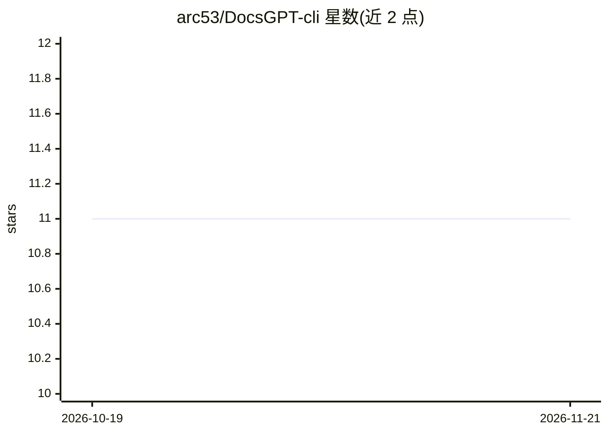

# arc53/DocsGPT-cli

⭐ 11 · Go · MIT · 推送 2026-11-20 · [GitHub](https://github.com/arc53/DocsGPT-cli) · [官网](https://www.docsgpt.cloud/) · 组织维护

**终端用户：在终端与 DocsGPT 代理对话与管理的 CLI 工具**

基于 Go 编写的命令行客户端，连接 DocsGPT 代理服务：全屏流式对话、单次提问、管道输入（如 git diff/tail 传给代理）、粘贴截图与附加文件、按目录保存会话并可继续。代理可在本地执行命令、读写文件（逐次审批），支持 MCP 服务器工具、答案附带引用来源、代理与来源以 YAML 导出供 CI 应用、答案基准测试、主机模式后台任务，并提供 Go SDK 与自动更新。需配合 DocsGPT 服务的 API key 使用。

## 筛选速览

| 维度 | 判定 | 备注 |
|---|---|---|
| AI 角色 | `ai-native` | 本体是模型或模型工具 |
| 许可风险 | `permissive` | MIT |
| 部署形态 | `library` | 以包/库形式分发 |
| 模型依赖 | — | README 未给出锁定关系 |
| 硬件要求 | — | 无带数字的原话,不猜 |
| 安装摩擦 | `low` | 无编译、无系统依赖或容器化 |
| 成熟度 | — | 结构信号不足 |

## 能力要点

- 全屏流式对话，支持管道输入与非终端纯文本输出
- 代理本地工具执行需逐次审批，支持 MCP 服务器工具
- 代理与来源可导出为 YAML，通过 CI 应用
- Bench 功能可对代理答案做断言并比较代理与模型

## 适用场景

- 在终端里直接向 DocsGPT 代理提问并附加文件
- 把 git diff 或日志通过管道发给代理做分析
- 以代码化管理代理与文档来源并在 CI 中应用
- 对代理答案做基准断言测试

## 场景标签

`AI 助手` `文档问答` · 领域:对话与助手

## 证据(README 行号)

> L3: Chat with your DocsGPT agents from the
> L29: docsgpt-cli                                  # chat

## 星数曲线

2026-10-19 11 → 2026-11-21 11（+0）

---
*卡片 v1 · prompt 1.4 · 生成 2026-11-18 · 置信度 high · 依据 README sha `aa08f3ec7c06` · [字段定义](../../DATASET.md)*
