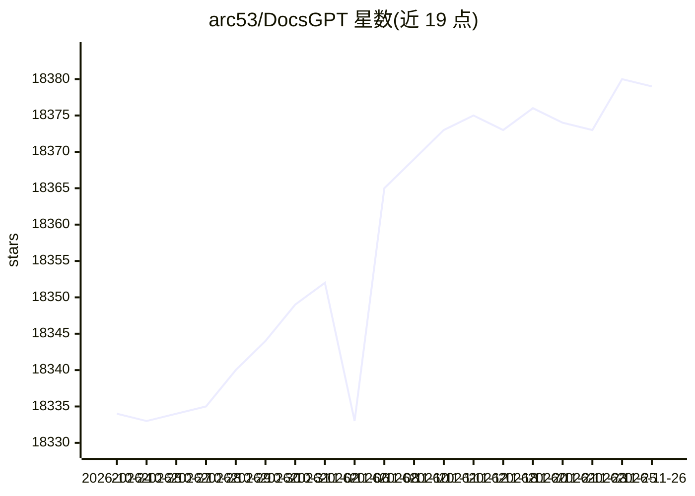

# arc53/DocsGPT

⭐ 18,379 · Python · MIT · 推送 2026-11-25 · [GitHub](https://github.com/arc53/DocsGPT) · [官网](https://app.docsgpt.cloud/) · 组织维护

**基于自有文档构建私有 AI agent 与企业搜索的自托管平台**

DocsGPT 将文档、网站和连接的应用转化为带引用来源的 AI agent：支持可视化工作流编排、知识库同步（Google Drive、SharePoint、Confluence、GitHub、S3 等）与 GraphRAG，提供 web 搜索、REST API、MCP 服务器、沙箱代码等工具，并内置 PII/提示注入防护栏。可在自有环境完全自托管，支持云或本地模型，包含 SSO、团队与配额等团队功能。安装器依赖 Docker，也支持 pip、Kubernetes 与离线部署。

## 筛选速览

| 维度 | 判定 | 备注 |
|---|---|---|
| AI 角色 | `ai-native` | 本体是模型或模型工具 |
| 许可风险 | `permissive` | MIT |
| 部署形态 | `self-host` | docker 或自建部署 |
| 模型依赖 | local-ok | 支持本地模型 |
| 硬件要求 | — | 无带数字的原话,不猜 |
| 安装摩擦 | `low` | 无编译、无系统依赖或容器化 |
| 成熟度 | — | 结构信号不足 |

## 动量与使用信号

- 维护:`active` — 距上次 push 0.7 天,年发版 12,246 位贡献者
- 涨星:近 1 天 **+1**(自 20261016 起算)
- 下载:GitHub Release 附件 累计 286(27 个 release)
- 平台:WINDOWS / MACOS / LINUX · 协议:OPENAI-API / MCP / OLLAMA

## 能力要点

- agent 与深度研究模式：多步生成带来源引用的回答
- 可视化工作流构建器：拖拽式串联 agent、条件与沙箱代码
- 多模型接入：OpenAI、Anthropic、Google、Groq 或经 Ollama/vLLM 用本地模型
- MIT 许可，自托管含 SSO（OIDC/SCIM）、角色权限与用量配额

## 适用场景

- 把产品手册和内部文档变成可引用来源的问答助手
- 在自有环境搭建企业知识搜索与 agent 工作流
- 通过网页组件或 OpenAI 兼容 API 把 agent 集成到产品中

## 场景标签

`RAG` `文档问答` `工作流自动化` · 领域:效率与自动化

## 证据(README 行号)

> L44: DocsGPT turns your documents, sites and connected apps into AI agents that answer with sources. Build agents and
> L60: - 🤖 **Agents and deep research:** agents with their own prompt, knowledge, tools and model, plus a research mode fo
> L65: - 🧠 **Any model:** OpenAI, Anthropic, Google, Groq, OpenRouter, or local models through Ollama, vLLM and other Open

## 星数曲线

2026-10-24 18,334 → 2026-11-26 18,379（+45）

---
*卡片 v1 · prompt 1.4 · 生成 2026-11-25 · 置信度 high · 依据 README sha `aec0c85dc9a2` · [字段定义](../../DATASET.md)*
