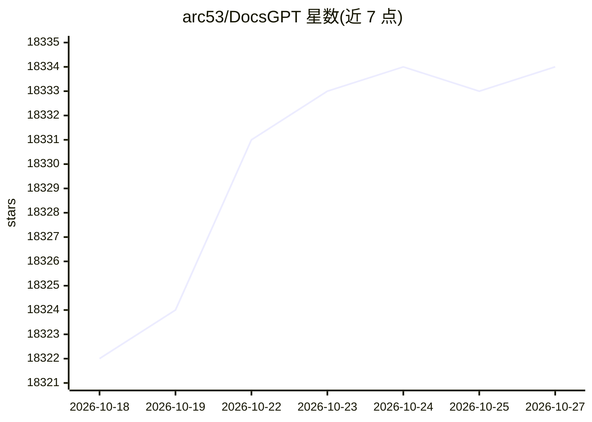

# arc53/DocsGPT

⭐ 18,334 · Python · MIT · 推送 2026-10-26 · [GitHub](https://github.com/arc53/DocsGPT) · [官网](https://app.docsgpt.cloud/) · 组织维护

**面向企业与开发者的自托管文档问答与 AI Agent 平台**

DocsGPT 将文档、网站与已连接的应用转为可引用出处的 AI Agent：支持可视化工作流编排、知识同步（Google Drive、SharePoint、Confluence、GitHub、S3 等）与 GraphRAG，每个回答附带来源引用。模型可任选云端（OpenAI、Anthropic、Groq 等）或本地（Ollama、vLLM），整个栈运行在用户自身环境内。提供一键安装脚本、`docsgpt` CLI 管理命令，另有 Docker Compose、pip、Kubernetes 及离线部署途径；MIT 许可，包含 SSO、团队与配额等团队功能。

## 筛选速览

| 维度 | 判定 | 备注 |
|---|---|---|
| AI 角色 | `ai-native` | 本体是模型或模型工具 |
| 许可风险 | `permissive` | MIT |
| 部署形态 | `self-host` | docker 或自建部署 |
| 模型依赖 | local-ok | 支持本地模型 |
| 硬件要求 | — | 无带数字的原话,不猜 |
| 安装摩擦 | `low` | 无编译、无系统依赖或容器化 |
| 成熟度 | — | 结构信号不足 |

## 动量与使用信号

- 维护:`active` — 距上次 push 0.7 天,年发版 12,246 位贡献者
- 涨星:近 1 天 **+1**(自 20261016 起算)
- 下载:GitHub Release 附件 累计 286(27 个 release)
- 平台:WINDOWS / MACOS / LINUX · 协议:OPENAI-API / MCP / OLLAMA

## 能力要点

- Agent 与深度研究模式：自定义提示、知识与工具，支持多步回答
- 拖拽式可视化工作流：串联 Agent、条件与沙箱代码
- 答案带来源引用，知识源可从多平台持续同步
- OpenAI 兼容 API、MCP server、网站 widget、Discord/Slack/Telegram 机器人与 CLI 多种接入方式

## 适用场景

- 在企业内网自建文档问答与知识检索系统
- 把产品手册做成嵌入网站的客服 Agent
- 需要数据不出本地环境的私有化 LLM 应用部署
- 通过可视化工作流串联多个 Agent 处理业务流程

## 场景标签

`文档问答` `RAG` `工作流自动化` `Agent 框架` · 领域:Agent 开发

## 证据(README 行号)

> L3:  Open-source AI agents grounded in your docs. Private, self-hosted, any model.
> L45: DocsGPT turns your documents, sites and connected apps into AI agents that answer with sources. Build agents and
> L66: - 🧠 **Any model:** OpenAI, Anthropic, Google, Groq, OpenRouter, or local models through Ollama, vLLM and other Open

## 星数曲线

2026-10-18 18,322 → 2026-10-27 18,334（+12）

---
*卡片 v1 · prompt 1.4 · 生成 2026-10-18 · 置信度 high · 依据 README sha `884449f4b35c` · [字段定义](../../DATASET.md)*
