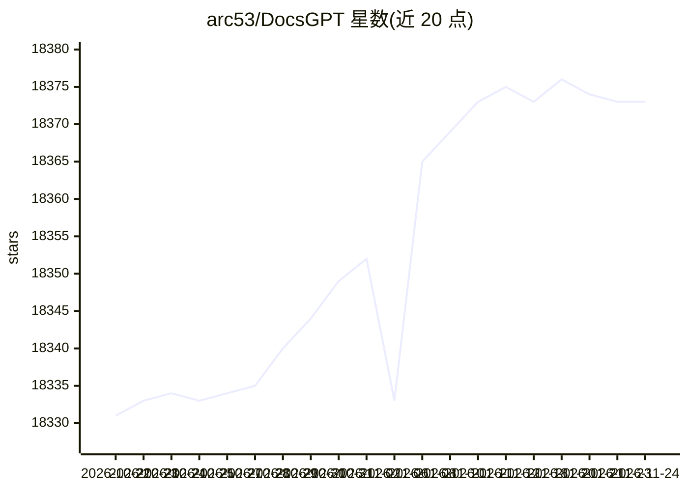

# arc53/DocsGPT

⭐ 18,380 · Python · MIT · 推送 2026-11-23 · [GitHub](https://github.com/arc53/DocsGPT) · [官网](https://app.docsgpt.cloud/) · 组织维护

**企业级私有化 AI 问答与 Agent 平台：文档接地回答**

自托管的 AI 平台，将文档、网站和接入的应用转化为带出处的 AI 代理：内置代理构建器、可视化工作流、深度研究模式、多源知识同步（Google Drive、SharePoint、Confluence、GitHub、S3 等）与 GraphRAG。每个回答附引用来源，支持 OpenAI 兼容 API、聊天挂件、MCP 服务器、Discord/Slack/Telegram 机器人等交付形式。全部组件运行在用户自己的环境内，MIT 许可，提供单命令安装脚本与 docsgpt CLI 管理栈。

## 筛选速览

| 维度 | 判定 | 备注 |
|---|---|---|
| AI 角色 | `ai-native` | 本体是模型或模型工具 |
| 许可风险 | `permissive` | MIT |
| 部署形态 | `self-host` | docker 或自建部署 |
| 模型依赖 | local-ok | 支持本地模型 |
| 硬件要求 | — | 无带数字的原话,不猜 |
| 安装摩擦 | `low` | 无编译、无系统依赖或容器化 |
| 成熟度 | — | 结构信号不足 |

## 动量与使用信号

- 维护:`active` — 距上次 push 0.7 天,年发版 12,246 位贡献者
- 涨星:近 1 天 **+1**(自 20261016 起算)
- 下载:GitHub Release 附件 累计 286(27 个 release)
- 平台:WINDOWS / MACOS / LINUX · 协议:OPENAI-API / MCP / OLLAMA

## 能力要点

- 代理与可视化工作流：提示词、知识、工具与模型可组合编排
- 知识源同步与 GraphRAG，回答附文档引用
- 多模型接入：OpenAI、Anthropic、Groq、Ollama、vLLM 等 OpenAI 兼容服务器
- 团队功能：OIDC/SCIM 单点登录、角色权限、用量配额与 OpenTelemetry 观测

## 适用场景

- 在企业内网自托管文档问答助手
- 为产品支持页面嵌入带出处的聊天挂件
- 把内部知识库通过 MCP 服务器暴露给 Claude、Cursor 等客户端
- 搭建定时运行或 webhook 触发的自动化代理

## 场景标签

`文档问答` `RAG` `知识图谱` `工作流自动化` · 领域:效率与自动化

## 证据(README 行号)

> L44: DocsGPT turns your documents, sites and connected apps into AI agents that answer with sources. Build agents and
> L63: - 🔎 **Answers with sources:** every answer cites the documents it came from.
> L65: - 🧠 **Any model:** OpenAI, Anthropic, Google, Groq, OpenRouter, or local models through Ollama, vLLM and other Open

## 星数曲线

2026-10-22 18,331 → 2026-11-24 18,373（+42）

---
*卡片 v1 · prompt 1.4 · 生成 2026-11-23 · 置信度 high · 依据 README sha `ef46aec0e0a7` · [字段定义](../../DATASET.md)*
