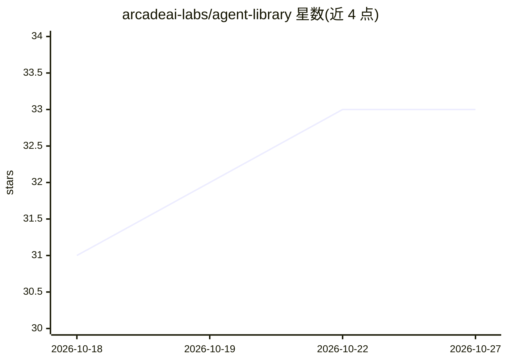

# arcadeai-labs/agent-library

⭐ 33 · Python · Apache-2.0 · 推送 2026-10-01 · [GitHub](https://github.com/arcadeai-labs/agent-library) · [官网](https://arcadeai-labs.github.io/agent-library/) · 组织维护

**给 AI agent 的个人知识库：MCP 服务器与 CLI，支持混合检索**

面向 AI agent 的持久化知识存储：以 SQLite（sqlite-vec 向量检索 + FTS5 全文 BM25）存储文本、代码、PDF 与图片（可 OCR），提供语义/关键词/混合三模检索与 MMR 多样性排序。通过 MCP 服务器（stdio/HTTP）供 Claude Desktop、Cursor、VS Code 等接入，也可用 libr CLI 直接增删查改与批量导入目录。嵌入模型可选本地（all-MiniLM-L6-v2）或 OpenAI 兼容 API。由 Arcade.dev 工程师以社区项目形式维护，Apache 2.0 许可。

## 筛选速览

| 维度 | 判定 | 备注 |
|---|---|---|
| AI 角色 | `ai-ecosystem` | LLM/agent 周边工具 |
| 许可风险 | `permissive` | Apache-2.0 |
| 部署形态 | `library` | 以包/库形式分发 |
| 模型依赖 | — | README 未给出锁定关系 |
| 硬件要求 | — | 无带数字的原话,不猜 |
| 安装摩擦 | `medium` | 含编译或系统依赖之一 |
| 成熟度 | — | 结构信号不足 |

## 能力要点

- SQLite + sqlite-vec 向量检索与 FTS5/BM25 全文的混合搜索
- 多模态索引：文本、代码符号提取、PDF、图片元数据/可选 OCR
- MCP 服务器暴露 Librarian_* 系列工具，兼容 Claude/Cursor 等
- 本地或 OpenAI 兼容 API 的可配置嵌入模型

## 适用场景

- 为我的 agent 提供跨会话的持久记忆与语义检索
- 把笔记和文档目录批量导入后供 AI 助手查询
- 在 Claude Desktop 或 Cursor 中通过 MCP 访问个人知识库

## 场景标签

`Agent 记忆` `知识库管理` `语义搜索` · 领域:Agent 开发

## 证据(README 行号)

> L3: A personal knowledge library for AI agents, built on Arcade for the Model Context Protocol (MCP).
> L11: Agent Library provides AI agents with persistent storage for text, documents, and knowledge. Agents can store infor
> L85: ## MCP Server

## 星数曲线

2026-10-18 31 → 2026-10-27 33（+2）

---
*卡片 v1 · prompt 1.4 · 生成 2026-10-25 · 置信度 mid · 依据 README sha `06d16144cd2a` · [字段定义](../../DATASET.md)*
