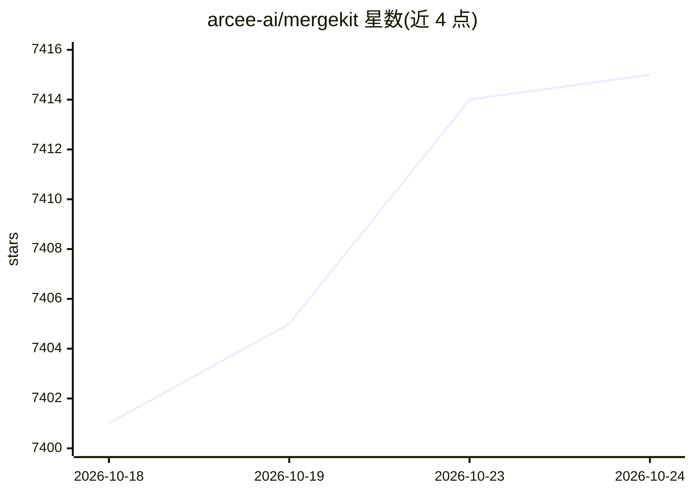

# arcee-ai/mergekit

⭐ 7,414 · Python · LGPL-3.0 · 推送 2026-10-22 · [GitHub](https://github.com/arcee-ai/mergekit) · 组织维护

**合并多个预训练语言模型权重的 Python 工具包**

mergekit 通过 YAML 配置描述合并方案，在权重空间组合多个预训练语言模型，支持多种合并算法、层切片拼装（Frankenmerging）、MoE 合并、LORA 提取、进化式合并与多阶段工作流。采用 out-of-core 方式与张量惰性加载，可在纯 CPU 或低至 8GB VRAM 的 GPU 上运行；支持 Llama、Mistral、GPT-NeoX、StableLM 等架构，可对齐不同词表的 tokenizer 并生成合并后的模型 README 供上传 Hugging Face Hub。面向需要组合既有模型能力、避免重新训练的开发者。

## 筛选速览

| 维度 | 判定 | 备注 |
|---|---|---|
| AI 角色 | `ai-ecosystem` | LLM/agent 周边工具 |
| 许可风险 | `viral` | LGPL-3.0 |
| 部署形态 | `library` | 以包/库形式分发 |
| 模型依赖 | — | README 未给出锁定关系 |
| 硬件要求 | — | 无带数字的原话,不猜 |
| 安装摩擦 | `medium` | 含编译或系统依赖之一 |
| 成熟度 | — | 结构信号不足 |

## 能力要点

- YAML 配置驱动的多种模型合并算法（含 SLERP/TIES 等）与多阶段合并
- 层切片拼装（Frankenmerging）与 MoE 合并、LORA 提取、进化式合并
- 纯 CPU 可运行，GPU 加速低至 8GB VRAM，惰性加载降低内存占用
- tokenizer 词表对齐（union/base/指定模型）与 chat_template 覆盖

## 适用场景

- 把多个专精模型合并为一个综合模型，保持单模型推理成本
- 不依赖训练数据在模型间迁移能力
- 合并不同词表/对话模板的模型并发布到 Hugging Face Hub

## 场景标签

 · 领域:LLM 工具/模型工程

## 证据(README 行号)

> L7: `mergekit` is a toolkit for merging pre-trained language models. `mergekit` uses an out-of-core approach to perform 
> L33: - Mixture of Experts merging
> L73: mergekit-yaml path/to/your/config.yml ./output-model-directory [--cuda] [--lazy-unpickle] [--allow-crimes] [... oth

## 星数曲线

2026-10-18 7,401 → 2026-10-24 7,415（+14）

---
*卡片 v1 · prompt 1.4 · 生成 2026-10-20 · 置信度 mid · 依据 README sha `4ccb8487771a` · [字段定义](../../DATASET.md)*
