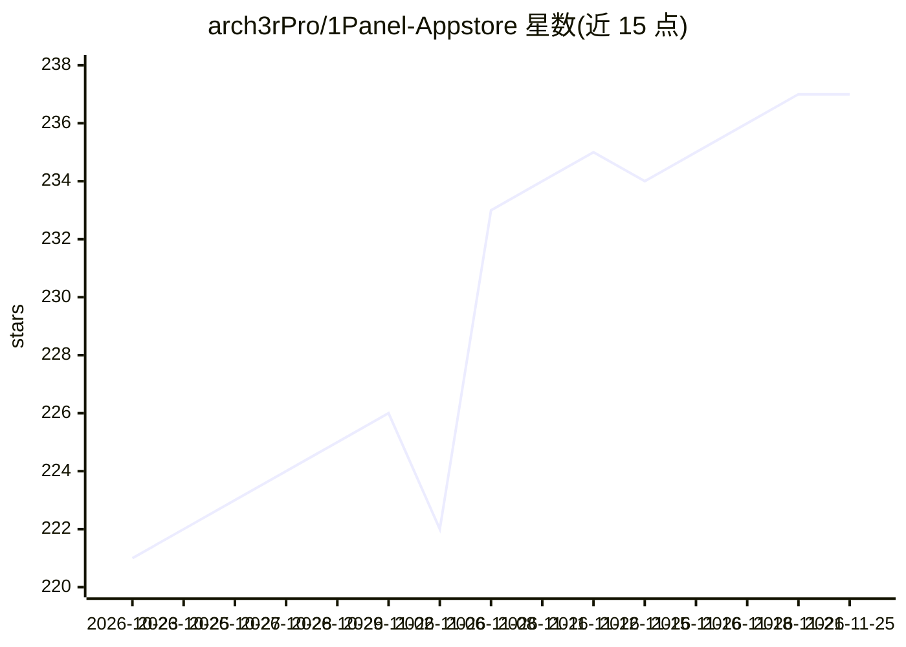

# arch3rPro/1Panel-Appstore

⭐ 237 · CSS · MIT · 推送 2026-11-23 · [GitHub](https://github.com/arch3rPro/1Panel-Appstore) · [官网](https://arch3rpro.github.io/appstore) · 个人维护 · 中文 README

**1Panel 面板的第三方应用商店：脚本化安装更新开源应用**

面向 1Panel 用户的第三方应用合集仓库，收录 AI 应用、文档管理、安全网络、多媒体、运维监控与 NAS 工具等类别的开源项目。通过粘贴 Shell 脚本到 1Panel 计划任务实现应用的自动化安装与更新；另提供 Skill 配置，可在 Cursor、Windsurf、Claude Code 等 AI 客户端中由用户提供 GitHub 项目链接或 Docker 镜像名，生成 data.yml、docker-compose.yml 等完整应用配置。仓库申明为非官方个人项目，不对镜像有效性做保证。

## 筛选速览

| 维度 | 判定 | 备注 |
|---|---|---|
| AI 角色 | `ai-knowledge` | 知识聚合/清单类 |
| 许可风险 | `permissive` | MIT |
| 部署形态 | `self-host` | docker 或自建部署 |
| 模型依赖 | — | README 未给出锁定关系 |
| 硬件要求 | — | 无带数字的原话,不猜 |
| 安装摩擦 | `low` | 无编译、无系统依赖或容器化 |
| 成熟度 | — | 结构信号不足 |

## 能力要点

- 通过 1Panel 计划任务脚本自动化安装与更新应用
- 提供 AI Skill 配置，自动生成 1Panel 应用配置文件
- 收录 AI 与智能应用、免费大模型逆向 API、运维监控、NAS 工具等类别
- 含 Free-API 系列下架与供应链投毒风险的申明记录

## 适用场景

- 在 1Panel 面板中一键部署 LobeHub、Dify 等 AI 应用
- 用 AI 客户端为新开源项目生成 1Panel 应用配置
- 搭建内网穿透、服务器监控、NAS 文件同步等自托管服务

## 场景标签

 · 领域:运维/应用生态聚合

## 证据(README 行号)

> L10: - 本仓库包含多个适用于 1Panel 的应用，旨在为用户提供简单、快速的安装与更新体验。应用均为开源项目，支持通过 1Panel 的计划任务功能自动化安装和更新。通过仓库提供的脚本，可以轻松地将应用集成到 1Panel 系统中。
> L15: - 非官方，第三方应用商店
> L36: 本仓库提供了 Skill 配置，支持在 Cursor、Windsurf、Claude Code 等 AI 客户端中快速生成 1Panel 应用配置。

## 星数曲线

2026-10-23 221 → 2026-11-25 237（+16）

---
*卡片 v1 · prompt 1.4 · 生成 2026-11-25 · 置信度 high · 依据 README sha `ce91630d3616` · [字段定义](../../DATASET.md)*
