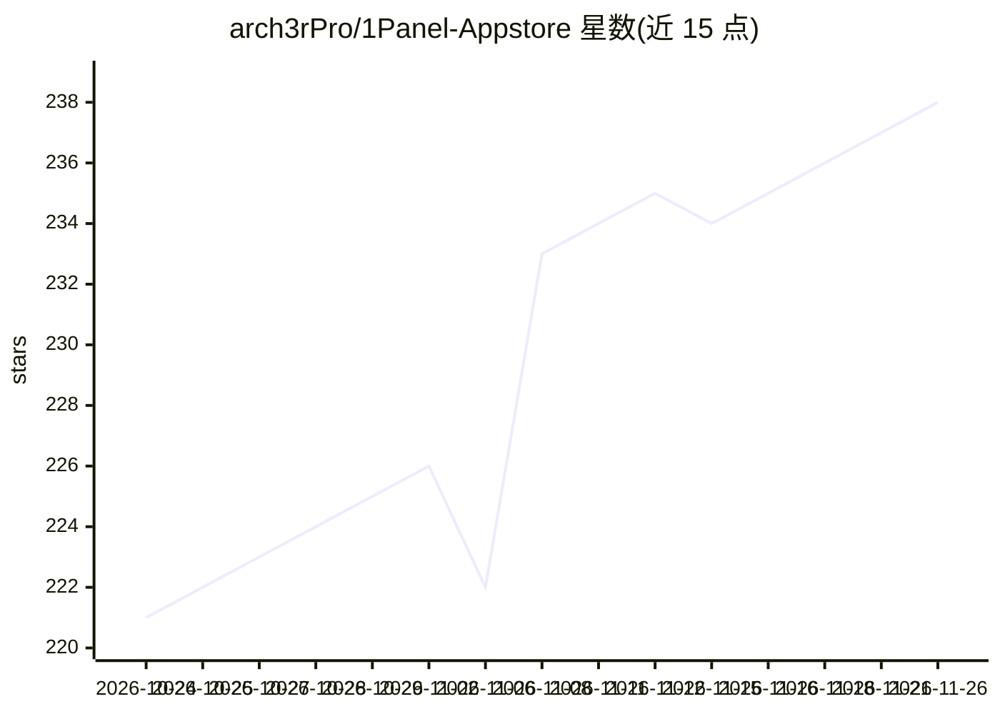

# arch3rPro/1Panel-Appstore

⭐ 238 · CSS · MIT · 推送 2026-11-25 · [GitHub](https://github.com/arch3rPro/1Panel-Appstore) · [官网](https://arch3rpro.github.io/appstore) · 个人维护 · 中文 README

**1Panel 用户的第三方应用商店：脚本化安装约百款开源应用**

面向 1Panel 面板用户的应用仓库，收录约百个开源项目的部署配置，覆盖 AI 应用、LLM 免费逆向 API、文档管理、安全网络、多媒体、运维监控与 NAS 工具等类别。使用方式是把仓库提供的 Shell 脚本加入 1Panel 计划任务，实现应用的自动化安装与更新。另提供 Skill 配置，可在 Cursor、Windsurf、Claude Code 等 AI 客户端中根据 GitHub 项目地址自动生成 1Panel 应用配置（data.yml、docker-compose.yml、双语 README、图标）。仓库为非官方第三方项目，声明不对镜像有效性作保证。

## 筛选速览

| 维度 | 判定 | 备注 |
|---|---|---|
| AI 角色 | `ai-enhanced` | 去掉 AI 部分产品仍成立 |
| 许可风险 | `permissive` | MIT |
| 部署形态 | `self-host` | docker 或自建部署 |
| 模型依赖 | — | README 未给出锁定关系 |
| 硬件要求 | — | 无带数字的原话,不猜 |
| 安装摩擦 | `low` | 无编译、无系统依赖或容器化 |
| 成熟度 | — | 结构信号不足 |

## 能力要点

- 通过 1Panel 计划任务脚本自动化安装与更新应用
- 提供 Skill 配置，AI 客户端可自动生成应用配置文件
- 应用按 AI、文档、安全网络、多媒体、运维监控、NAS 分类
- 声明部分 Free-API 应用因供应链投毒曾下架后重构上架

## 适用场景

- 用 1Panel 一键部署 Dify、LobeHub 等 AI 应用
- 自托管服务器监控、内网穿透等运维工具
- 让 AI 客户端帮我生成新的 1Panel 应用配置

## 场景标签

 · 领域:服务器运维/应用部署

## 证据(README 行号)

> L10: - 本仓库包含多个适用于 1Panel 的应用，旨在为用户提供简单、快速的安装与更新体验。应用均为开源项目，支持通过 1Panel 的计划任务功能自动化安装和更新。通过仓库提供的脚本，可以轻松地将应用集成到 1Panel 系统中。
> L15: - 非官方，第三方应用商店
> L34: ### 🤖 使用 AI 快速生成应用配置

## 星数曲线

2026-10-24 221 → 2026-11-26 238（+17）

---
*卡片 v1 · prompt 1.4 · 生成 2026-11-26 · 置信度 high · 依据 README sha `90d4b58a934f` · [字段定义](../../DATASET.md)*
