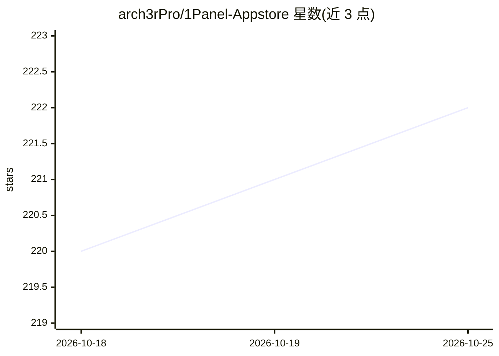

# arch3rPro/1Panel-Appstore

⭐ 222 · CSS · MIT · 推送 2026-10-23 · [GitHub](https://github.com/arch3rPro/1Panel-Appstore) · [官网](https://arch3rpro.github.io/appstore) · 个人维护 · 中文 README

**1Panel 第三方应用商店：精选自托管应用的一键部署合集**

面向 1Panel 服务器面板用户的第三方应用商店仓库，收录 AI 应用（LobeChat、Dify、New-API、LiteLLM、MCP 工具等）、免费 LLM 逆向 API（DeepSeek/Kimi/Qwen/GLM 等）、文档管理、安全网络、多媒体、运维监控与 NAS 工具类应用，通过 1Panel 计划任务执行 Shell 脚本自动安装与更新。仓库声明非官方、不对镜像有效性做保证，曾因供应链投毒下架 Free-API 系列后部分重新上架。另提供 SKILL 配置，可在 Cursor、Windsurf、Claude Code 等 AI 客户端中自动生成新应用的 1Panel 配置。

## 筛选速览

| 维度 | 判定 | 备注 |
|---|---|---|
| AI 角色 | `ai-knowledge` | 知识聚合/清单类 |
| 许可风险 | `permissive` | MIT |
| 部署形态 | `self-host` | docker 或自建部署 |
| 模型依赖 | — | README 未给出锁定关系 |
| 硬件要求 | — | 无带数字的原话,不猜 |
| 安装摩擦 | `low` | 无编译、无系统依赖或容器化 |
| 成熟度 | — | 结构信号不足 |

## 能力要点

- 收录 AI 应用、免费 LLM API、文档、安全、监控、NAS 等多类第三方应用
- 通过 1Panel 计划任务脚本自动安装与更新
- 提供 Skill 配置，用 AI 客户端从 GitHub 链接生成应用配置（data.yml/docker-compose 等）
- 声明非官方仓库，不对原始镜像有效性做保证，安全风险自查

## 适用场景

- 在 1Panel 中一键部署 LobeChat、Dify 等自托管 AI 应用
- 搭建服务器监控与运维工具合集
- 通过对话让 AI 客户端生成新的 1Panel 应用配置并提交

## 场景标签

 · 领域:服务器运维/自托管应用分发

## 证据(README 行号)

> L10: - 本仓库包含多个适用于 1Panel 的应用，旨在为用户提供简单、快速的安装与更新体验。应用均为开源项目，支持通过 1Panel 的计划任务功能自动化安装和更新。通过仓库提供的脚本，可以轻松地将应用集成到 1Panel 系统中。
> L67: ### 📱 应用列表

## 星数曲线

2026-10-18 220 → 2026-10-25 222（+2）

---
*卡片 v1 · prompt 1.4 · 生成 2026-10-22 · 置信度 mid · 依据 README sha `b120363298cc` · [字段定义](../../DATASET.md)*
