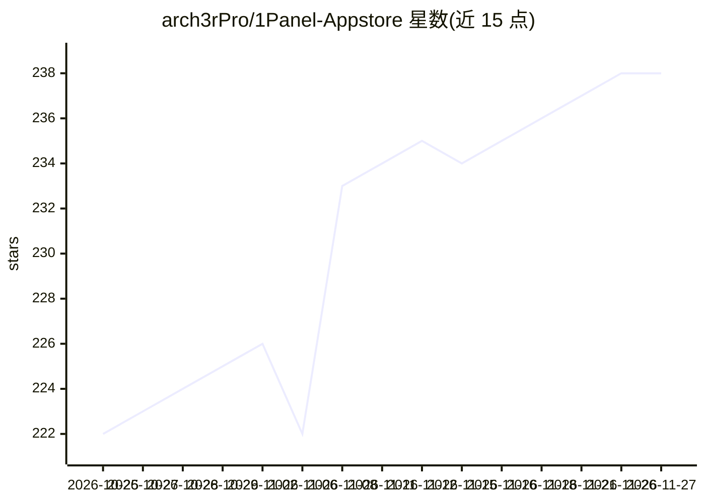

# arch3rPro/1Panel-Appstore

⭐ 238 · CSS · MIT · 推送 2026-11-26 · [GitHub](https://github.com/arch3rPro/1Panel-Appstore) · [官网](https://arch3rpro.github.io/appstore) · 个人维护 · 中文 README

**为 1Panel 用户提供第三方应用合集的自动化安装更新仓库**

个人维护的非官方 1Panel 第三方应用商店，收录 AI 网关、LLM 逆向 API、文档管理、安全网络、多媒体、运维监控、Nas 工具等分类的多个开源应用。通过 1Panel 计划任务执行仓库提供的 Shell 脚本完成应用的安装与更新。另提供 Skill 配置，可在 Cursor、Windsurf、Claude Code 等 AI 客户端中根据 GitHub 链接或需求描述生成 1Panel 应用配置（data.yml、docker-compose.yml、双语 README 等文件）。仓库声明不对镜像有效性做保证，部分 Free-API 应用曾因供应链投毒下架后重构上架。

## 筛选速览

| 维度 | 判定 | 备注 |
|---|---|---|
| AI 角色 | `ai-enhanced` | 去掉 AI 部分产品仍成立 |
| 许可风险 | `permissive` | MIT |
| 部署形态 | `self-host` | docker 或自建部署 |
| 模型依赖 | — | README 未给出锁定关系 |
| 硬件要求 | — | 无带数字的原话,不猜 |
| 安装摩擦 | `low` | 无编译、无系统依赖或容器化 |
| 成熟度 | — | 结构信号不足 |

## 能力要点

- 通过 1Panel 计划任务脚本实现应用自动化安装与更新
- 提供 SKILL.md 技能配置，AI 客户端可生成完整应用配置
- 收录多个类别的开源应用并附版本信息与介绍文档链接
- 标注 Free-API 系列的供应链投毒下架与重构上架情况

## 适用场景

- 在 1Panel 上一键安装和更新合集内的自托管应用
- 用 AI 客户端为新开源项目快速生成 1Panel 应用配置
- 搭建 AI 网关、知识库等自托管服务
- 自建服务器监控、内网穿透等运维工具

## 场景标签

`精选清单` · 领域:学习与行业

## 证据(README 行号)

> L10: - 本仓库包含多个适用于 1Panel 的应用，旨在为用户提供简单、快速的安装与更新体验。应用均为开源项目，支持通过 1Panel 的计划任务功能自动化安装和更新。通过仓库提供的脚本，可以轻松地将应用集成到 1Panel 系统中。
> L36: 本仓库提供了 Skill 配置，支持在 Cursor、Windsurf、Claude Code 等 AI 客户端中快速生成 1Panel 应用配置。
> L67: ### 📱 应用列表

## 星数曲线

2026-10-25 222 → 2026-11-27 238（+16）

---
*卡片 v1 · prompt 1.4 · 生成 2026-11-27 · 置信度 mid · 依据 README sha `5ffb3c1f27f6` · [字段定义](../../DATASET.md)*
