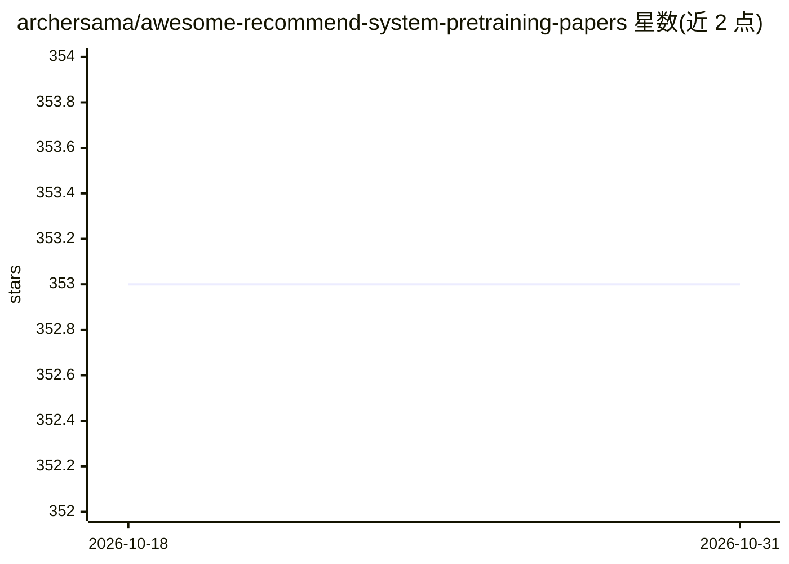

# archersama/awesome-recommend-system-pretraining-papers

⭐ 353 · 推送 2026-03-19 · [GitHub](https://github.com/archersama/awesome-recommend-system-pretraining-papers) · 个人维护 · 中文 README

**推荐系统预训练模型论文清单：面向科研人员的文献目录**

由北京大学 Xiangyang Li 维护的论文列表，收录推荐系统预训练方向的文献，按综述、数据集、实证研究、序列/会话推荐、用户表示预训练、双塔预训练、语言模型作为推荐模型、图预训练等类别组织，条目附论文链接，部分附代码链接。同时覆盖 LLM 用于推荐（ChatGPT 评测、P5、TALLRec 等）相关研究，并列出相关工作坊与相关 hub。内容以论文索引为主，不提供可运行的代码或安装方式。

## 筛选速览

| 维度 | 判定 | 备注 |
|---|---|---|
| AI 角色 | `ai-knowledge` | 知识聚合/清单类 |
| 许可风险 | `none` | — |
| 部署形态 | `None` |  |
| 模型依赖 | — | README 未给出锁定关系 |
| 硬件要求 | — | 无带数字的原话,不猜 |
| 安装摩擦 | `low` | 无编译、无系统依赖或容器化 |
| 成熟度 | — | 结构信号不足 |

## 动量与使用信号

- 安装:github 包 `release-assets` 月下载无数据

## 能力要点

- 按 8+ 个研究类别组织的论文索引，条目附论文链接
- 覆盖 LLM 用于推荐的子方向（P5、TALLRec、LlamaRec 等）
- 收录数据集清单（Yelp、Tenrec、PixelRec、NineRec 等）
- 部分论文附代码仓库链接

## 适用场景

- 查找推荐系统预训练方向的论文与综述
- 调研 LLM 用于推荐系统的研究进展
- 寻找推荐系统预训练相关的公开数据集

## 场景标签

`精选清单` `推荐系统` · 领域:学习与行业

## 证据(README 行号)

> L1: # A Paper List for Recommend-system PreTrained Models
> L5: This is a paper list for pretrained recommend System (recommendation) models. It also contains some related research

## 星数曲线

2026-10-18 353 → 2026-10-31 353（+0）

---
*卡片 v1 · prompt 1.4 · 生成 2026-10-18 · 置信度 high · 依据 README sha `b5c4ce44fe05` · [字段定义](../../DATASET.md)*
