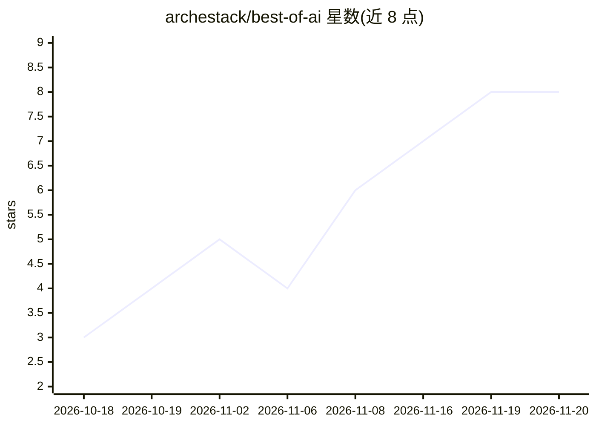

# archestack/best-of-ai

⭐ 8 · MIT · 推送 2026-11-19 · [GitHub](https://github.com/archestack/best-of-ai) · [官网](https://archestack.com/best-of-ai/) · 组织维护

**面向选型者的开源 AI 项目排名清单（1,801 个，21 类）**

由 Archestack 维护的开源 AI 项目排名清单：收录 1,801 个项目，覆盖聊天应用、agent 平台、RAG、模型服务、开源模型、向量数据库、网关、可观测性、MCP 服务器等 21 个类别。每个条目给出优势、弱点、规格与基于公开 GitHub 数据的评分（活跃度、维护、agent-ready 等），每两个月核对一次并每日重排两次，另提供网页版与本周星标上升榜。

## 筛选速览

| 维度 | 判定 | 备注 |
|---|---|---|
| AI 角色 | `ai-knowledge` | 知识聚合/清单类 |
| 许可风险 | `permissive` | MIT |
| 部署形态 | `None` |  |
| 模型依赖 | — | README 未给出锁定关系 |
| 硬件要求 | — | 无带数字的原话,不猜 |
| 安装摩擦 | `low` | 无编译、无系统依赖或容器化 |
| 成熟度 | — | 结构信号不足 |

## 能力要点

- 1,801 个开源 AI 项目按 21 个类别排名
- 每个条目含优势、弱点与基于公开 GitHub 信号的评分
- 列出各项目 GPU 需求与 arm64/Apple Silicon 支持情况
- 提供开源替代品对照表与场景化选择指南

## 适用场景

- 按类别浏览并比较开源 AI 项目
- 寻找某个商业产品的开源替代品
- 根据 GPU/硬件条件筛选可本地运行的项目

## 场景标签

`精选清单` · 领域:学习与行业

## 证据(README 行号)

> L11:  Best of Open-Source AI is a ranked list of 1,801 open-source AI projects: chat apps and assistants, desktop apps, 
> L148: - 📖 Learning and cookbooks · 136

## 星数曲线

2026-10-18 3 → 2026-11-20 8（+5）

---
*卡片 v1 · prompt 1.4 · 生成 2026-11-20 · 置信度 high · 依据 README sha `709cc8780fc0` · [字段定义](../../DATASET.md)*
