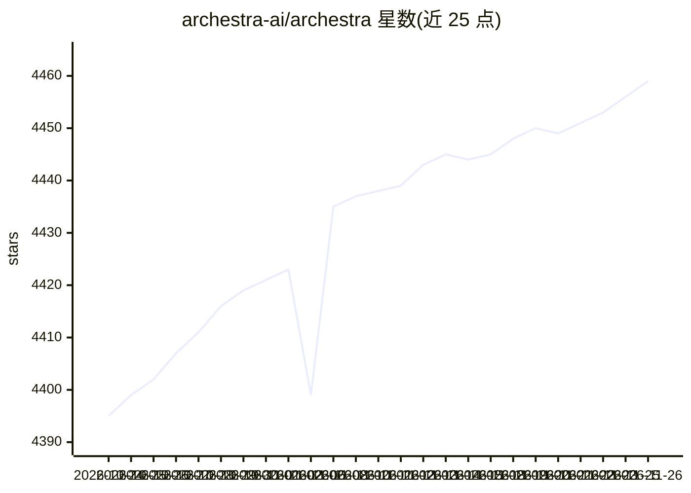

# archestra-ai/archestra

⭐ 4,459 · TypeScript · NOASSERTION · 推送 2026-11-25 · [GitHub](https://github.com/archestra-ai/archestra) · [官网](https://Archestra.AI) · 组织维护

**面向企业的 AI 平台：护栏、MCP 注册表、网关与编排器**

面向企业的统一 AI 平台：将用户、Agent 或 Claude/Codex/Cursor 等客户端指向单一 URL，由平台提供聊天助手、LLM 网关（支持费用限额、虚拟 API key、动态模型路由）、MCP 网关（OAuth 与 On-Behalf-Of 身份代理）、A2A 网关、私有 MCP 注册表、Kubernetes 算子的 MCP 编排器、Agent 运行时、RAG 知识库与确定性工具调用护栏。内置 SSO/RBAC、沙箱代码执行、OpenTelemetry 追踪与 Prometheus 指标。通过 Docker/Helm/Kubernetes 部署；采用 Open Core 定价模型，30 人以下团队免费，企业需商业许可。

## 筛选速览

| 维度 | 判定 | 备注 |
|---|---|---|
| AI 角色 | `ai-ecosystem` | LLM/agent 周边工具 |
| 许可风险 | `none` | NOASSERTION |
| 部署形态 | `self-host` | docker 或自建部署 |
| 模型依赖 | locked-api |  |
| 硬件要求 | — | 无带数字的原话,不猜 |
| 安装摩擦 | `low` | 无编译、无系统依赖或容器化 |
| 成熟度 | — | 结构信号不足 |

## 能力要点

- LLM 网关对接多家供应商，提供费用限额、虚拟 API key 与动态模型路由
- MCP 网关支持 OAuth 与 On-Behalf-Of，工具以用户身份运行
- 带 Kubernetes 算子的 MCP 编排器与私有 MCP 注册表
- 确定性护栏（Lethal Trifecta 防护）与 OpenTelemetry/Prometheus 可观测性

## 适用场景

- 为企业内部用户提供带项目与 MCP 应用的 AI 助手
- 统一管理企业内多个 LLM 供应商的接入、成本与路由
- 团队私有发布并集中管理 MCP 工具
- 为已在运行单租户 Agent 的企业提供迁移套件

## 场景标签

`模型网关` `AI 助手` `RAG` · 领域:Agent 开发

## 证据(README 行号)

> L35: - 🚪 **LLM gateway** for any provider
> L40: - 🔌 **MCP gateway** with OAuth + On-Behalf-Of
> L43: - 📦 **Private MCP registry** so teams ship their own tools — see

## 星数曲线

2026-10-24 4,395 → 2026-11-26 4,459（+64）

---
*卡片 v1 · prompt 1.4 · 生成 2026-11-23 · 置信度 high · 依据 README sha `e05aa7d138c9` · [字段定义](../../DATASET.md)*
