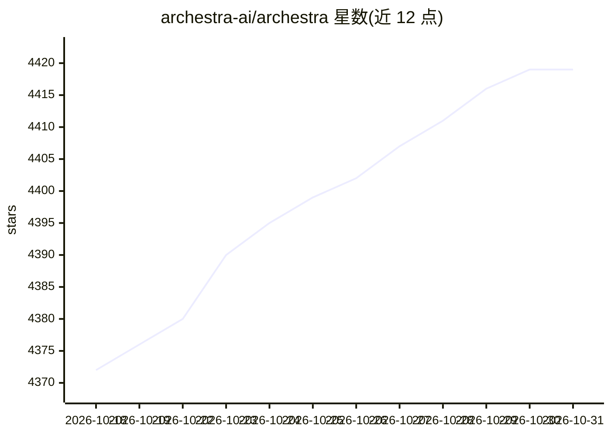

# archestra-ai/archestra

⭐ 4,419 · TypeScript · NOASSERTION · 推送 2026-10-30 · [GitHub](https://github.com/archestra-ai/archestra) · [官网](https://Archestra.AI) · 组织维护

**企业级一体化 AI 平台：LLM/MCP 网关、注册表与编排器**

面向企业部署的开源 AI 平台，将多个组件整合到一个 URL 之后：面向非技术用户的聊天助手（Slack/Teams/邮件前端）、支持多 provider 的 LLM 网关（成本限额、虚拟 API key、动态模型路由）、带 OAuth 的 MCP 网关与私有 MCP 注册表、Kubernetes operator 的 MCP 编排器、带沙箱代码执行的 agent 运行时、RAG 知识库与小程序构建器。安全与可观测性内置：SSO/RBAC、Lethal-Trifecta 防护、OpenTelemetry 与 Prometheus。通过 Docker/Helm/Kubernetes 部署，采用 Open Core 定价（30 人以下团队免费，企业需商业许可）。

## 筛选速览

| 维度 | 判定 | 备注 |
|---|---|---|
| AI 角色 | `ai-ecosystem` | LLM/agent 周边工具 |
| 许可风险 | `none` | NOASSERTION |
| 部署形态 | `self-host` | docker 或自建部署 |
| 模型依赖 | — | README 未给出锁定关系 |
| 硬件要求 | — | 无带数字的原话,不猜 |
| 安装摩擦 | `low` | 无编译、无系统依赖或容器化 |
| 成熟度 | — | 结构信号不足 |

## 能力要点

- 多 provider LLM 网关：虚拟 API key、成本限额、动态模型路由
- MCP 网关/注册表/编排器，OAuth + On-Behalf-Of 按用户身份运行工具
- SSO/RBAC、沙箱代码执行与 Lethal-Trifecta 防护
- OpenTelemetry traces 与 Prometheus 指标、按团队成本追踪

## 适用场景

- 为企业统一收口多家 LLM provider 的访问与成本管控
- 让团队通过私有 MCP 注册表发布和编排内部工具
- 为 Claude Code / Codex / Cursor 等客户端提供单一 token 的代理入口

## 场景标签

`模型网关` `聊天机器人` `RAG` `LLM 可观测性` · 领域:Agent 开发

## 证据(README 行号)

> L35: - 🚪 **LLM gateway** for any provider
> L40: - 🔌 **MCP gateway** with OAuth + On-Behalf-Of
> L45: - 🎼 **MCP orchestrator** with a

## 星数曲线

2026-10-18 4,372 → 2026-10-31 4,419（+47）

---
*卡片 v1 · prompt 1.4 · 生成 2026-10-21 · 置信度 high · 依据 README sha `3e24d762e135` · [字段定义](../../DATASET.md)*
