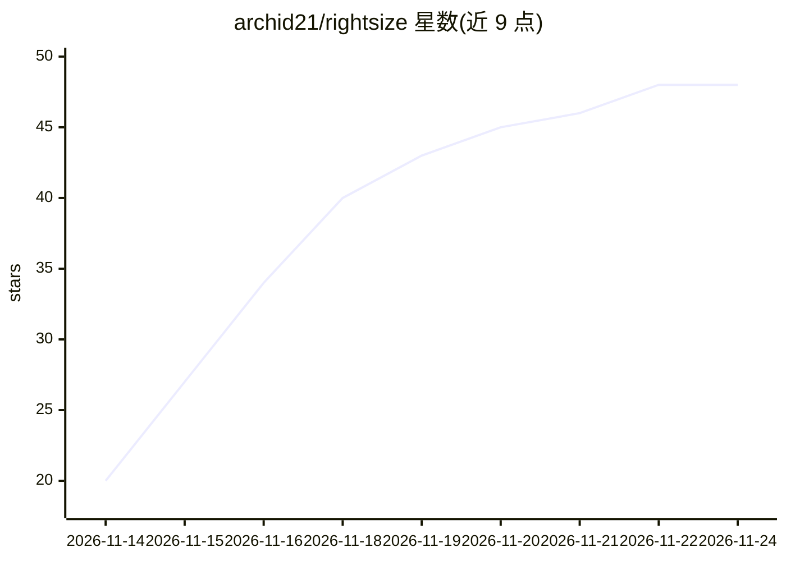

# archid21/rightsize

⭐ 49 · TypeScript · MIT · 推送 2026-11-23 · [GitHub](https://github.com/archid21/rightsize) · [官网](https://aivalue.blog/rightsize) · 个人维护

**给 Claude Code 用户的模型路由与 token 成本控制插件**

以 Claude Code 插件形式运行的模型选择与成本控制器：对每个提示做评级，把例行工作发给 Haiku/Sonnet 等更便宜的模型或更低 effort，仅在回合中出现重复失败、循环等信号时提高 effort；评审类任务单回合切换到 Opus。同时管理 prompt cache 保温、上下文填充告警、按需压缩（compact），并通过 /rightsize report 输出成本报表，watch-only 模式可只观察不改动。面向 Claude 订阅（Pro/Max/Ultra）或 API key 用户，基准测试为自称结果。

## 筛选速览

| 维度 | 判定 | 备注 |
|---|---|---|
| AI 角色 | `ai-ecosystem` | LLM/agent 周边工具 |
| 许可风险 | `permissive` | MIT |
| 部署形态 | `None` |  |
| 模型依赖 | locked-api |  |
| 硬件要求 | — | 无带数字的原话,不猜 |
| 安装摩擦 | `low` | 无编译、无系统依赖或容器化 |
| 成熟度 | — | 结构信号不足 |

## 能力要点

- 按提示评级将例行工作路由到更便宜模型，评审任务单回合切换 Opus
- effort 仅在回合中出现重复失败/循环/连续修复失败时上调
- cache 保温决策与上下文 40–90% 填充告警、按需压缩
- /rightsize report 成本报表与 watch-only 观察模式

## 适用场景

- 降低 Claude Code 日常编码的 token 开销
- 避免固定用 Opus 导致的 5 小时/周用量上限提前耗尽
- 在评审等关键任务上按回合自动获得更强模型
- 查看 cache 重建与压缩的实际成本明细

## 场景标签

`模型网关` `LLM 可观测性` · 领域:Agent 开发

## 证据(README 行号)

> L5: rightsize sends each prompt to the cheapest model and effort that does the job, raises effort only when Claude is ac
> L32: Claude Code runs every prompt on the model you picked, at the effort you picked. So you pay one of two prices:
> L43: |Smart routing|Routine work on cheaper models, Opus where it counts|Automatic. **Ask before changing** in `/config`

## 星数曲线

2026-11-14 20 → 2026-11-24 48（+28）

---
*卡片 v1 · prompt 1.4 · 生成 2026-11-18 · 置信度 high · 依据 README sha `e0fefef0c2cc` · [字段定义](../../DATASET.md)*
