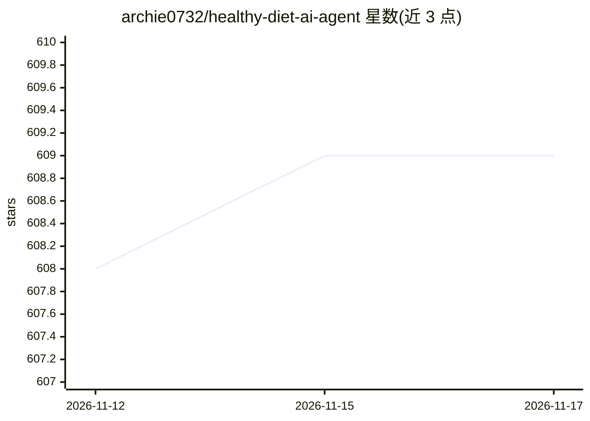

# archie0732/healthy-diet-ai-agent

⭐ 609 · TypeScript · MIT · 推送 2026-09-28 · [GitHub](https://github.com/archie0732/healthy-diet-ai-agent) · 个人维护 · 中文 README

**营养建议 AI agent 与版本感知 RAG 检索研究后端**

Bun + TypeScript 的营养问答 AI agent 后端，含食物图像 YOLO 识别、RAG 文档摄取与基于知识的饮食建议，并研究一个检索层开放问题：当官方指南存在多版本时如何检索。方法为条件式版本感知检索：时间意图路由器仅在显式历史/对比查询时触发谱系配对，其余查询与 BM25+recency 基线一致。报告了 V6 负结果与 V7 先导实验（40 题，Recall@3 +0.425），采用冻结参数、SHA-256 密封标签、单次运行守卫等防泄漏评估协议。仅评估检索阶段，不评估生成质量，且为小规模先导实验。

## 筛选速览

| 维度 | 判定 | 备注 |
|---|---|---|
| AI 角色 | `ai-native` | 本体是模型或模型工具 |
| 许可风险 | `permissive` | MIT |
| 部署形态 | `self-host` | docker 或自建部署 |
| 模型依赖 | — | README 未给出锁定关系 |
| 硬件要求 | — | 无带数字的原话,不猜 |
| 安装摩擦 | `low` | 无编译、无系统依赖或容器化 |
| 成熟度 | — | 结构信号不足 |

## 能力要点

- LangGraph agent + Rust API + YOLO 食物识别，docker compose up 一键启动
- 条件式版本感知检索：仅显式历史查询触发跨版本谱系配对
- 预注册式评估协议：冻结方法包、密封金标签、单次运行守卫、独立重算指标
- 完整报告 V6 负结果及其根因诊断与修复过程

## 适用场景

- 搭建可对话的营养建议与食物图像识别后端
- 研究指南多版本场景下的 RAG 检索策略
- 复用其防数据泄漏的 RAG 评估协议做类似实验

## 场景标签

`RAG` `目标检测` · 领域:知识与检索

## 证据(README 行号)

> L13: This repository contains a nutrition-advice AI agent and the research behind its retrieval layer. It is the **follo
> L26: - **Deployable system.** The research sits inside a working application: a LangGraph agent (TypeScript/Bun), a Rust

## 星数曲线

2026-11-12 608 → 2026-11-17 609（+1）

---
*卡片 v1 · prompt 1.4 · 生成 2026-11-17 · 置信度 mid · 依据 README sha `443b7a724258` · [字段定义](../../DATASET.md)*
