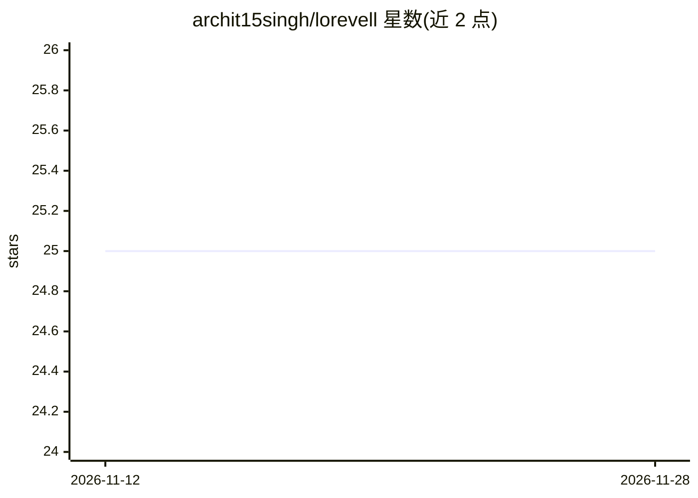

# archit15singh/lorevell

⭐ 25 · Rust · MIT · 推送 2026-11-26 · [GitHub](https://github.com/archit15singh/lorevell) · [官网](https://archit15singh.github.io/posts/2026-02-28-designing-cli-tools-for-ai-agents/) · 个人维护

**面向人类与编码代理的本地 Markdown 知识库 CLI**

以纯 Markdown 文件为知识源、SQLite 为一次性索引的本地知识库工具：提供笔记写入、混合检索（关键词/本地语义向量 AllMiniLM-L6-V2）、双向链接、只读外部快照召回、Git 版本化与回滚。由 Rust 实现，带 CLI、本地浏览器 UI 与 Python 绑定；自身不实现代理运行时或模型，推理交给 Claude Code 或 Codex 等既有代理。支持通过 setup 安装学习技能、dream 命令做带评测门控的批量知识整理。源码构建需 Python 3.9+ 与 Rust 工具链，2.0 接口为破坏性变更，不自动迁移 1.x。

## 筛选速览

| 维度 | 判定 | 备注 |
|---|---|---|
| AI 角色 | `ai-ecosystem` | LLM/agent 周边工具 |
| 许可风险 | `permissive` | MIT |
| 部署形态 | `library` | 以包/库形式分发 |
| 模型依赖 | — | README 未给出锁定关系 |
| 硬件要求 | — | 无带数字的原话,不猜 |
| 安装摩擦 | `low` | 无编译、无系统依赖或容器化 |
| 成熟度 | — | 结构信号不足 |

## 能力要点

- Markdown 为唯一真相源，SQLite 索引可随时重建
- 关键词/本地向量混合检索，--text-only 支持离线无模型流程
- dream 批量整理带 --eval-set 检索质量门控与 Git 回滚
- 为 Claude Code / Codex 安装搜索-学习技能（.claude/skills 或 .agents/skills）

## 适用场景

- 让编码代理在调查前检索既有经验、沉淀可复用教训
- 维护带双向链接与回顾队列的个人知识库
- 对他人系统拥有的记忆做只读快照召回与受限审阅

## 场景标签

`知识库管理` `Agent 记忆` · 领域:Agent 开发

## 证据(README 行号)

> L7: For Lorevell-owned vaults, Markdown is the source of truth. Read-only external recall keeps its configured source au
> L11:     Agent[Claude Code / Codex] --> CLI[Lorevell CLI]

## 星数曲线

2026-11-12 25 → 2026-11-28 25（+0）

---
*卡片 v1 · prompt 1.4 · 生成 2026-11-18 · 置信度 mid · 依据 README sha `e8bf69965523` · [字段定义](../../DATASET.md)*
