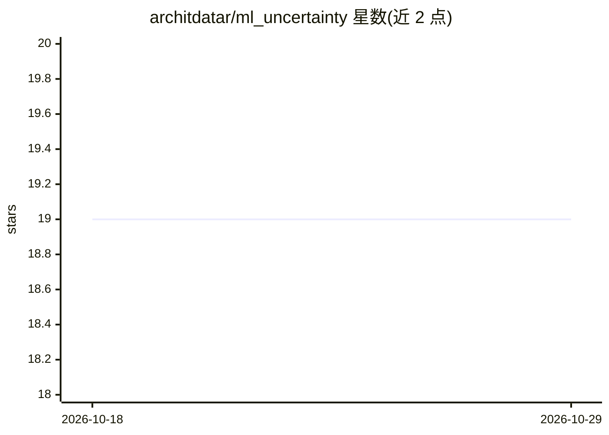

# architdatar/ml_uncertainty

⭐ 19 · Python · MIT · 推送 2026-02-09 · [GitHub](https://github.com/architdatar/ml_uncertainty) · 个人维护

**给 ML 模型加预测区间与参数不确定性的 Python 库**

提供 scikit-learn 风格 API 的 Python 包，接受已拟合的 scikit-learn 模型作为输入，用统计方法量化机器学习模型的不确定性。功能包括模型参数显著性检验（含集成模型特征重要性判断）、预测/置信区间生成、输入与参数到输出的误差传播，以及 scikit-learn 式非线性回归拟合。面向数据科学家与 ML 爱好者，代码量少即可完成推断；参数方法与集成方法基于相应统计理论，部分类已与 statsmodels 做过基准对比。

## 筛选速览

| 维度 | 判定 | 备注 |
|---|---|---|
| AI 角色 | `ai-native` | 本体是模型或模型工具 |
| 许可风险 | `permissive` | MIT |
| 部署形态 | `library` | 以包/库形式分发 |
| 模型依赖 | — | README 未给出锁定关系 |
| 硬件要求 | — | 无带数字的原话,不猜 |
| 安装摩擦 | `low` | 无编译、无系统依赖或容器化 |
| 成熟度 | — | 结构信号不足 |

## 能力要点

- 接受 scikit-learn 已拟合模型，输出预测区间与置信区间
- 模型参数显著性检验与集成模型特征重要性判断
- 误差传播：从输入/模型参数传递到输出
- scikit-learn 风格 API 的非线性回归拟合

## 适用场景

- 为回归模型补充预测区间与参数误差估计
- 检验模型参数或集成特征是否真实显著
- 将输入与参数误差传播到模型输出

## 场景标签

 · 领域:机器学习/统计

## 证据(README 行号)

> L12: ML Uncertainty is a Python package which provides a scikit-learn-like interface to obtain prediction intervals and 
> L67: * It takes scikit-learn fitted models as inputs and uses appropriate statistics to quantify the uncertainties in ML
> L84: 2. **Prediction intervals:** Can produce prediction and confidence intervals for parametric and non-parametric ML m

## 星数曲线

2026-10-18 19 → 2026-10-29 19（+0）

---
*卡片 v1 · prompt 1.4 · 生成 2026-10-28 · 置信度 high · 依据 README sha `ffa6ba413498` · [字段定义](../../DATASET.md)*
