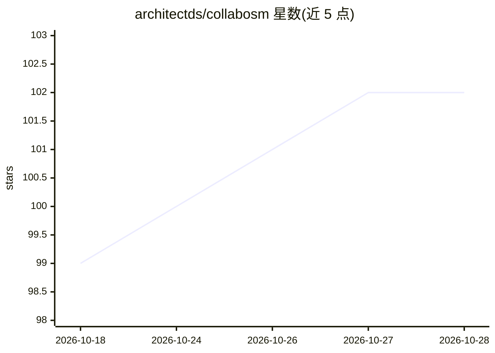

# architectds/collabosm

⭐ 102 · Python · MIT · 推送 2026-10-10 · [GitHub](https://github.com/architectds/collabosm) · 个人维护 · 中文 README

**租用自己 Colab 账号 GPU 运行 Qwen3.8 的本地聊天与 API 应用**

本地运行的桌面应用：通过用户自己的 Google Colab 账号租用 A100 GPU（40G 运行 Qwen3.8-27B，80G 运行 Flash-Next 125B-A6B），启动前显示费用，提供带图像附件的聊天界面，并在本机固定地址 http://127.0.0.1:3020/v1 提供 OpenAI 兼容 API，供 Codex、ModelDock 等程序调用。内置自动停止（20 分钟无消息/6 小时）、计算单元余额与消耗展示、每 10 分钟心跳保活与连接诊断。GPU 按 Colab 计算单元计费（约 $0.68/小时），需付费 Colab 订阅，免费额度不可用；本地需 Python 3.12+，通过 git clone 或 ZIP 下载后运行 Python 脚本启动。

## 筛选速览

| 维度 | 判定 | 备注 |
|---|---|---|
| AI 角色 | `ai-native` | 本体是模型或模型工具 |
| 许可风险 | `permissive` | MIT |
| 部署形态 | `desktop` | 安装包/桌面程序 |
| 模型依赖 | — | README 未给出锁定关系 |
| 硬件要求 | — | 无带数字的原话,不猜 |
| 安装摩擦 | `low` | 无编译、无系统依赖或容器化 |
| 成熟度 | — | 结构信号不足 |

## 能力要点

- 在自己 Colab 账号上按分钟租用 A100，启动前显示费用
- 本地固定 /v1 端点提供 OpenAI 兼容 API，附 Codex/ModelDock 配置说明
- 自动停止（20 分钟无消息或 6 小时）与计算单元余额/速率实时展示
- 每 10 分钟经 Colab 通道的心跳保活与四层连接诊断

## 适用场景

- 用自己的 Colab 付费账号按需运行大参数模型并聊天
- 让 Codex 等 OpenAI 客户端通过本地端点使用租用 GPU 上的模型
- 聊天中附带图片提问，结束后一键停止 GPU 控制花费

## 场景标签

`聊天机器人` `推理引擎` · 领域:对话与助手

## 证据(README 行号)

> L5: collabosm lets you use a large AI model — **Qwen3.8-27B**, or **Qwen3.8-Flash-Next** — running on
> L6: a powerful GPU that is rented in **your own Google Colab account**. You chat with it in a simple
> L229: While a GPU is running, other programs on your computer can use the model through collabosm. Any

## 星数曲线

2026-10-18 99 → 2026-10-28 102（+3）

---
*卡片 v1 · prompt 1.4 · 生成 2026-10-23 · 置信度 mid · 依据 README sha `9938cbba9e2a` · [字段定义](../../DATASET.md)*
