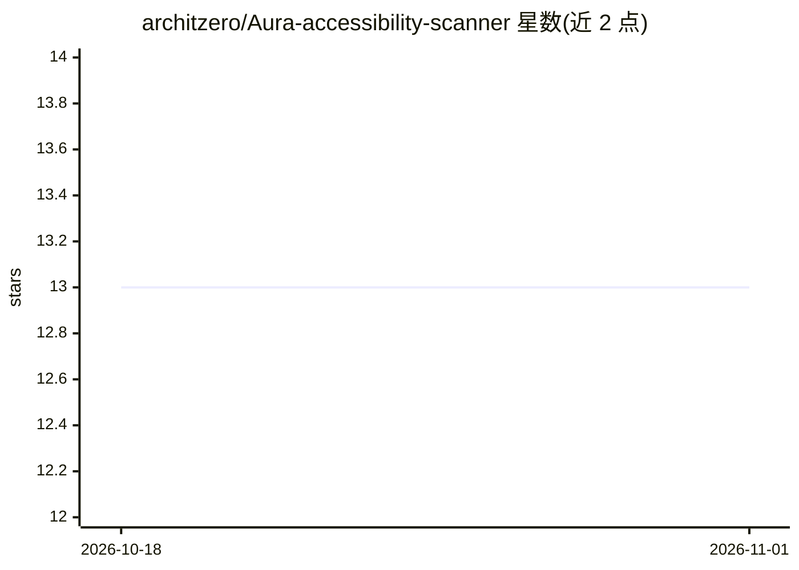

# architzero/Aura-accessibility-scanner

⭐ 13 · Python · 推送 2026-02-26 · [GitHub](https://github.com/architzero/Aura-accessibility-scanner) · 个人维护

**Web 无障碍审计平台：扫描 WCAG 违规并给出 AI 修复建议**

全栈 Web 无障碍审计平台：后端用 Playwright 驱动浏览器并运行 Axe-core 扫描网站，检查 WCAG 2.1 合规性，按严重程度计分并存储扫描历史。AI 部分为三类建议：用 Hugging Face BLIP 模型为缺 alt 图片生成描述文字、计算符合 4.5:1 对比度的颜色修复值、用 Flesch-Kincaid 分析文本可读性。面向开发者，需 Python 3.11+ 与 MongoDB Atlas 账户，从源码克隆安装后以 uvicorn 运行 FastAPI 后端。

## 筛选速览

| 维度 | 判定 | 备注 |
|---|---|---|
| AI 角色 | `ai-enhanced` | 去掉 AI 部分产品仍成立 |
| 许可风险 | `none` | — |
| 部署形态 | `library` | 以包/库形式分发 |
| 模型依赖 | — | README 未给出锁定关系 |
| 硬件要求 | — | 无带数字的原话,不猜 |
| 安装摩擦 | `low` | 无编译、无系统依赖或容器化 |
| 成熟度 | — | 结构信号不足 |

## 能力要点

- Playwright + Axe-core 扫描网站 WCAG 2.1 合规性
- BLIP 模型为图片生成 alt 文本建议
- 按严重程度计分（Critical 10 分至 Minor 2 分）并跟踪扫描历史
- JWT 认证与 SSRF 防护等安全措施

## 适用场景

- 对线上网站做 WCAG 2.1 合规审计并查看严重度评分
- 为缺 alt 的图片获得 AI 生成的替代文本建议
- 获取符合对比度要求的颜色修复方案

## 场景标签

 · 领域:Web 开发工具/无障碍

## 证据(README 行号)

> L3: Aura is a full-stack web accessibility platform that combines **Axe-core** scanning with **AI-powered suggestions** 
> L84: 3. AI analyzes violations:

## 星数曲线

2026-10-18 13 → 2026-11-01 13（+0）

---
*卡片 v1 · prompt 1.4 · 生成 2026-10-31 · 置信度 mid · 依据 README sha `4faa5e787b3e` · [字段定义](../../DATASET.md)*
