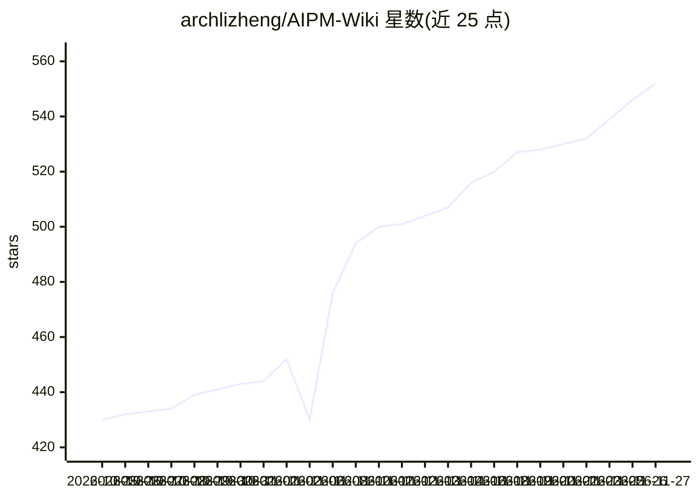

# archlizheng/AIPM-Wiki

⭐ 552 · NOASSERTION · 推送 2026-11-06 · [GitHub](https://github.com/archlizheng/AIPM-Wiki) · 个人维护 · 中文 README

**面向 AI 产品经理入门者的中文知识库与面试题库**

以 Obsidian vault 形式组织的 AI 产品经理入门知识库，由破壁BreakingWall 维护，包含学习路线、AI 基础知识、PM 核心技能、应用案例拆解、面试题库与资源导航六个板块。内容用 Markdown 与双向链接组织，支持 GitHub 网页阅读或飞书只读版浏览；推荐搭配 Obsidian 与 Claudian 插件实现 AI 问答检索与知识图谱可视化。内容采用 CC BY-NC-SA 4.0 协议，禁止商用，欢迎社区 PR 共建。

## 筛选速览

| 维度 | 判定 | 备注 |
|---|---|---|
| AI 角色 | `ai-knowledge` | 知识聚合/清单类 |
| 许可风险 | `none` | NOASSERTION |
| 部署形态 | `None` |  |
| 模型依赖 | — | README 未给出锁定关系 |
| 硬件要求 | — | 无带数字的原话,不猜 |
| 安装摩擦 | `low` | 无编译、无系统依赖或容器化 |
| 成熟度 | — | 结构信号不足 |

## 能力要点

- 六大板块覆盖学习路线、AI 基础、核心技能、案例、面试题与资源
- Obsidian vault 结构，Markdown + 双向链接组织内容
- 推荐 Claudian 插件实现库内 AI 问答与检索
- 面试题遵循题目→考察点→参考答案→追问延伸的统一格式

## 适用场景

- 准备 AI 产品经理面试，刷概念题、设计题与面经
- 零基础转行，按学习路线从零建立知识框架
- 做成本测算或模型选型时查阅相关章节
- 拆解 ChatGPT、Perplexity 等应用案例建立产品 sense

## 场景标签

`教程课程` · 领域:学习与行业

## 证据(README 行号)

> L9: **面试题库 · AI 基础知识 · 应用案例拆解 · 学习路线**
> L31: > 让一个没有 AI 背景的产品经理(或想转行的同学),沿着目录从头读到尾,就能建立起 AI 产品经理的完整知识框架,并能应对主流公司的 AI 产品经理面试。
> L40: 本仓库是一个 Obsidian vault,用 Markdown + 双向链接组织内容。直接在 GitHub 网页上阅读完全没问题,但如果想要最佳体验——AI 问答检索、双向链接跳转、知识图谱可视化——推荐这样打开:

## 星数曲线

2026-10-25 430 → 2026-11-27 552（+122）

---
*卡片 v1 · prompt 1.4 · 生成 2026-11-25 · 置信度 high · 依据 README sha `3400885f20a3` · [字段定义](../../DATASET.md)*
