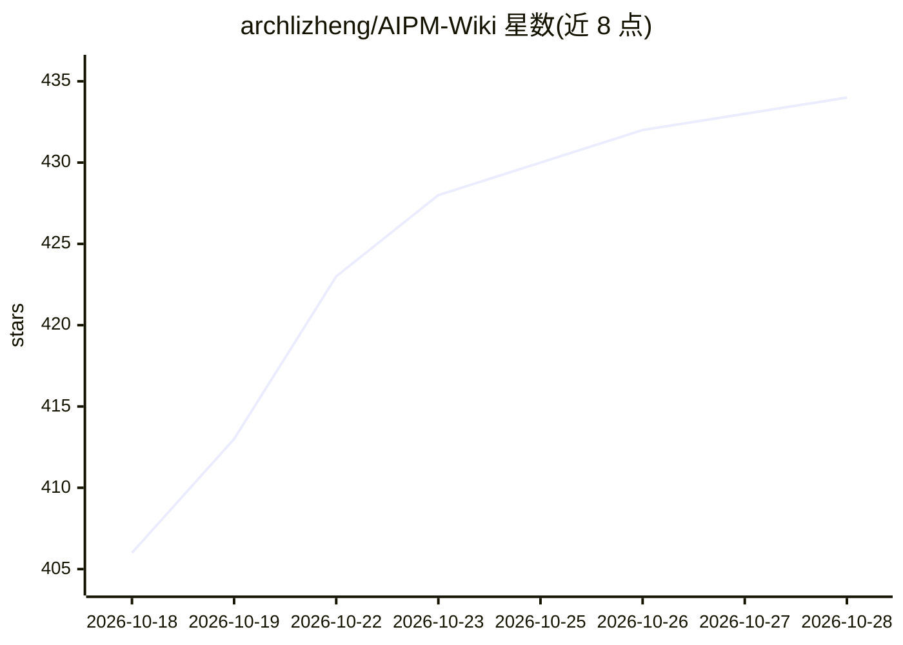

# archlizheng/AIPM-Wiki

⭐ 439 · NOASSERTION · 推送 2026-10-18 · [GitHub](https://github.com/archlizheng/AIPM-Wiki) · 个人维护 · 中文 README

**AI 产品经理入门知识库：面试题库与学习路线**

由个人维护者「破壁BreakingWall」构建的 Obsidian vault 形式知识库，用 Markdown 加双向链接组织内容，覆盖学习路线、AI 基础、PM 核心技能、应用案例拆解、面试题库与资源导航六大板块。可在 GitHub 网页阅读，或 clone 后用 Obsidian 打开获得 AI 问答检索、知识图谱可视化体验；另有飞书只读镜像版单向同步。技术与行情类内容标注了官方信源与访问时间，采用 CC BY-NC-SA 4.0 协议，社区通过 Issue/PR 共建。

## 筛选速览

| 维度 | 判定 | 备注 |
|---|---|---|
| AI 角色 | `ai-knowledge` | 知识聚合/清单类 |
| 许可风险 | `none` | NOASSERTION |
| 部署形态 | `None` |  |
| 模型依赖 | — | README 未给出锁定关系 |
| 硬件要求 | — | 无带数字的原话,不猜 |
| 安装摩擦 | `low` | 无编译、无系统依赖或容器化 |
| 成熟度 | — | 结构信号不足 |

## 能力要点

- 面试题库含概念题、设计题、案例题、行为面与 18 篇面经
- Obsidian vault 结构，支持双向链接与 Graph view 知识图谱
- 技术与行情类内容核实自官方文档并标注访问时间
- 提供飞书只读镜像版（单向同步）

## 适用场景

- 零基础转行 AI 产品经理的系统学习
- 准备主流公司 AI PM 面试时刷题与看面经
- 查阅 AI 术语与模型成本测算资料

## 场景标签

`教程课程` · 领域:学习与行业

## 证据(README 行号)

> L3: ### AI 产品经理入门知识库
> L56: |板块|内容|适合谁|

## 星数曲线

2026-10-18 406 → 2026-10-28 434（+28）

---
*卡片 v1 · prompt 1.4 · 生成 2026-10-21 · 置信度 high · 依据 README sha `e3f87d9d93d8` · [字段定义](../../DATASET.md)*
