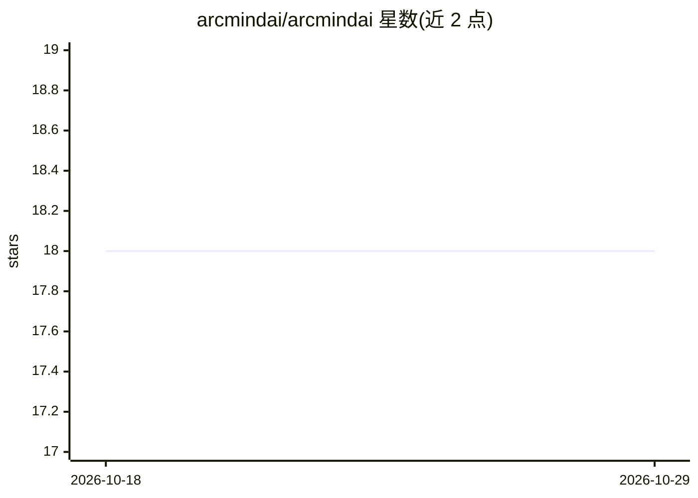

# arcmindai/arcmindai

⭐ 18 · Rust · MIT · 推送 2026-09-15 · [GitHub](https://github.com/arcmindai/arcmindai) · [官网](https://github.com/arcmindai/arcmindai) · 个人维护

**运行在互联网计算机区块链上的自主 AI Agent 与向量库系统**

以 Rust 编写、部署为 Internet Computer 智能合约（Canister）的长时运行自主 Agent：由主循环控制器编排 Brain（连接 GPT-3/4 等 LLM）、Tools（Google 搜索/网页浏览）与 Vector DB Canister（长期记忆、语义检索）共 4 个 Canister，通过 Chain of Thoughts 与长短期记忆执行任务。每用户拥有独立 Canister 套件，可经 NFID 访问，并可调用 BeamFi 智能合约流式支付。本地运行需配置 OpenAI/Google API key、dfx SDK 与本地 ICP 账本。LLM 远程或本地开源模型（如 LLama2）为规划方向。

## 筛选速览

| 维度 | 判定 | 备注 |
|---|---|---|
| AI 角色 | `ai-native` | 本体是模型或模型工具 |
| 许可风险 | `permissive` | MIT |
| 部署形态 | `library` | 以包/库形式分发 |
| 模型依赖 | — | README 未给出锁定关系 |
| 硬件要求 | — | 无带数字的原话,不猜 |
| 安装摩擦 | `low` | 无编译、无系统依赖或容器化 |
| 成熟度 | — | 结构信号不足 |

## 能力要点

- 4 个 Canister 架构：主循环控制器/Brain/Tools/Vector DB
- 长期记忆向量库支持语义检索
- 每用户独立 Canister 套件，经 NFID 访问
- 可调用 BeamFi 智能合约实现流式支付

## 适用场景

- 在去中心化区块链上运行带长期记忆的自主 AI Agent
- 通过自然语言提问获得 Chain of Thoughts 推理回答
- 让 Agent 代表用户执行链上操作（如流式支付）

## 场景标签

`Agent 记忆` `语义搜索` `Agent 框架` · 领域:Agent 开发

## 证据(README 行号)

> L5: Technically, ArcMind AI is a Long-Running Agent equipped with a primary main loop that can orchestrate various tools
> L92: ArcMind is composed of 4 canisters with a Main loop controller being the orchestrator and short-term memory store, 

## 星数曲线

2026-10-18 18 → 2026-10-29 18（+0）

---
*卡片 v1 · prompt 1.4 · 生成 2026-10-29 · 置信度 high · 依据 README sha `7baefad3c4c2` · [字段定义](../../DATASET.md)*
