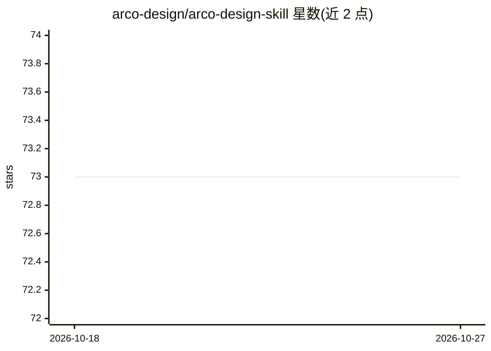

# arco-design/arco-design-skill

⭐ 73 · MIT · 推送 2026-06-03 · [GitHub](https://github.com/arco-design/arco-design-skill) · 组织维护 · 中文 README

**面向 AI agent 的 Arco Design 组件库技能文件集**

Arco Design 官方发布的 AI Skills 仓库：为 @arco-design/web-react（70 组件）与 @arco-design/web-vue（74 组件）提供 SKILL.md 格式的技能文件集，每个组件技能含 YAML frontmatter、可运行 TSX 示例、完整 API 表格、常见模式与最佳实践。AI agent 在编写 Arco Design 代码时按 description 匹配自动加载对应技能；子技能均标记 user-invocable: false。入口技能还包含与 Ant Design 的差异说明、组件分类索引与模式指南链接。面向使用 AI agent 编码的前端开发者。

## 筛选速览

| 维度 | 判定 | 备注 |
|---|---|---|
| AI 角色 | `ai-knowledge` | 知识聚合/清单类 |
| 许可风险 | `permissive` | MIT |
| 部署形态 | `None` |  |
| 模型依赖 | — | README 未给出锁定关系 |
| 硬件要求 | — | 无带数字的原话,不猜 |
| 安装摩擦 | `low` | 无编译、无系统依赖或容器化 |
| 成熟度 | — | 结构信号不足 |

## 能力要点

- 覆盖 React（70 组件）与 Vue（74 组件）两套组件库的技能文件
- 统一格式：YAML frontmatter + 可运行示例 + API 表格 + 最佳实践
- agent 按 description 自动加载子技能（user-invocable: false）
- 含与 Ant Design 的差异约定及表单/表格/弹窗等模式指南

## 适用场景

- 让 AI agent 编写 Arco Design 代码时获取准确 API 信息
- 前端开发中避免 agent 用错组件属性与用法
- 查阅 Arco 组件的模式指南与最佳实践

## 场景标签

`提示工程` `代码生成` · 领域:Agent 开发

## 证据(README 行号)

> L9: A collection of **skill files** covering the Arco Design React and Vue component libraries:
> L14: When writing code with Arco Design, AI agents automatically load the relevant skill to get accurate API info and be
> L31: 1. **YAML Frontmatter** — `name`, `description` (English, scenario-based), `user-invocable: false`

## 星数曲线

2026-10-18 73 → 2026-10-27 73（+0）

---
*卡片 v1 · prompt 1.4 · 生成 2026-10-24 · 置信度 high · 依据 README sha `e9540a964b89` · [字段定义](../../DATASET.md)*
