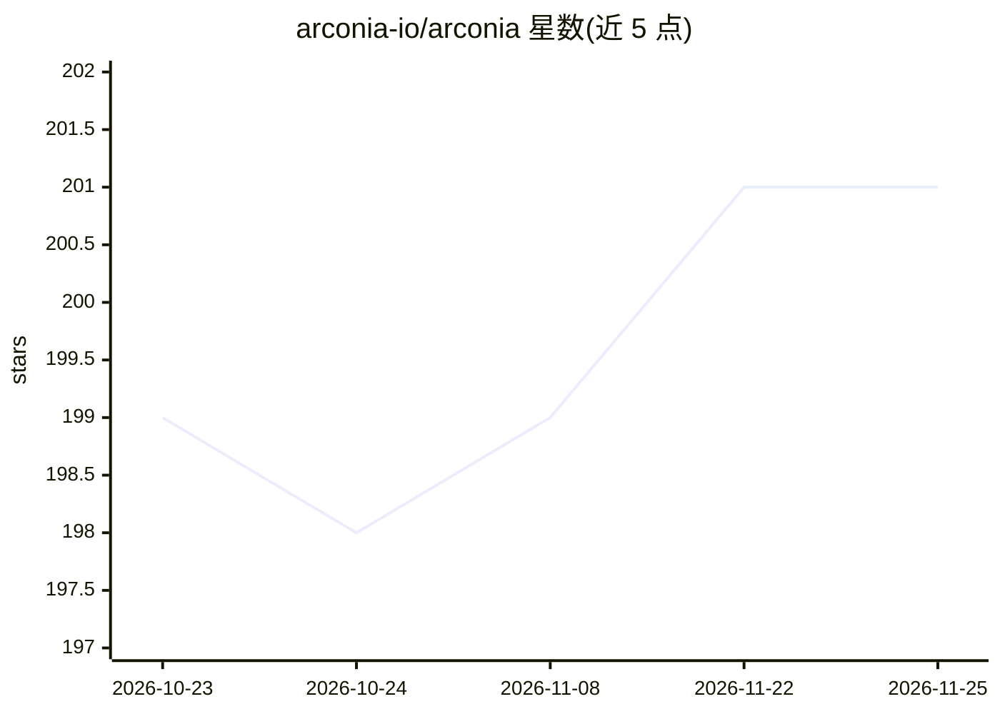

# arconia-io/arconia

⭐ 201 · Java · Apache-2.0 · 推送 2026-11-23 · [GitHub](https://github.com/arconia-io/arconia) · [官网](https://docs.arconia.io) · 组织维护

**Spring Boot 附加框架：提升 Java 企业应用开发体验与云原生能力**

Arconia 是面向 Java/Spring Boot 企业的附加框架，向现有 Spring Boot 应用添加云原生模式以减少样板代码。功能包括：自动以容器方式预置外部服务的 Dev Services、dev 模式下由应用自身提供的 Dev UI、OpenTelemetry 与 Micrometer 的统一可观测性、面向 AI 可观测性的语义约定插件（OpenInference/OpenLIT/OpenLLMetry/LangSmith 等）、基于 Docling 的文档结构化抽取、多租户与数据访问扩展。项目处于首个稳定版开发阶段。

## 筛选速览

| 维度 | 判定 | 备注 |
|---|---|---|
| AI 角色 | `ai-enhanced` | 去掉 AI 部分产品仍成立 |
| 许可风险 | `permissive` | Apache-2.0 |
| 部署形态 | `None` |  |
| 模型依赖 | — | README 未给出锁定关系 |
| 硬件要求 | — | 无带数字的原话,不猜 |
| 安装摩擦 | `low` | 无编译、无系统依赖或容器化 |
| 成熟度 | `idea` | |

## 能力要点

- Dev Services 以容器自动预置外部服务用于开发与测试
- OpenTelemetry + Micrometer 统一日志/指标/追踪
- AI 可观测性语义约定插件及 Arize Phoenix、Grafana LGTM 等平台集成
- Docling 从 PDF/Office/HTML 抽取结构化内容供 AI 管道使用

## 适用场景

- 为现有 Spring Boot 应用补充可观测性与多租户能力
- 本地开发/测试时自动拉起依赖的外部服务容器
- 为 Spring AI 应用接入 AI 可观测性语义约定

## 场景标签

`LLM 可观测性` · 领域:评测与运维

## 证据(README 行号)

> L5:  An add-on framework for Spring Boot, designed to enhance modern enterprise applications built with Java.
> L17: - **Dev Services.** First-class support for development and testing modes in Spring Boot applications. Dev Services
> L20: - **AI Observability.** Pluggable semantic conventions for AI observability, including OpenTelemetry, OpenInference

## 星数曲线

2026-10-23 199 → 2026-11-25 201（+2）

---
*卡片 v1 · prompt 1.4 · 生成 2026-11-25 · 置信度 mid · 依据 README sha `9fb170843a58` · [字段定义](../../DATASET.md)*
