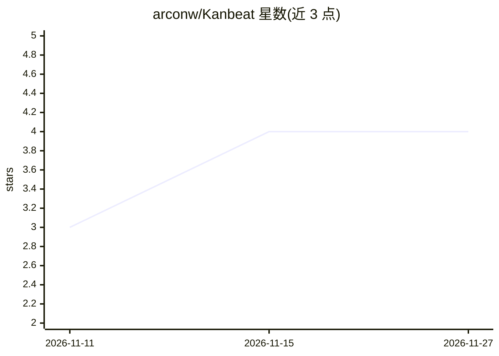

# arconw/Kanbeat

⭐ 4 · Python · Apache-2.0 · 推送 2026-11-11 · [GitHub](https://github.com/arconw/Kanbeat) · 个人维护

**开发者的本地 AI coding agent 会话多路复用看板**

本地优先的多路复用器与 TUI：每个项目运行一个常驻 supervisor，承载用户自己的 coding CLI（Codex、Claude Code、OpenCode、Pi），会话在关闭 TUI 后仍可存活并可重连。看板以 Markdown 文件为工单，工单所在目录即状态，支持 `Blocked by` 依赖声明、并行执行与 Review/QA 审查槽位。quick install 脚本自带 Python 运行时，或通过 uv/pipx/pip 从 Git 安装；仅支持 Linux/macOS，Windows 原生不支持，当前处于 Beta。

## 筛选速览

| 维度 | 判定 | 备注 |
|---|---|---|
| AI 角色 | `ai-ecosystem` | LLM/agent 周边工具 |
| 许可风险 | `permissive` | Apache-2.0 |
| 部署形态 | `desktop` | 安装包/桌面程序 |
| 模型依赖 | — | README 未给出锁定关系 |
| 硬件要求 | — | 无带数字的原话,不猜 |
| 安装摩擦 | `low` | 无编译、无系统依赖或容器化 |
| 成熟度 | `idea` | |

## 能力要点

- 工单即文件：.kanbeat/<column>/<id>-<slug>.md，可编辑、可脚本化、随项目提交
- 工单依赖声明（Blocked by）与 max_parallel 并行调度
- supervisor 常驻，会话脱离 TUI 后可重连，多个终端可观察同一看板
- 支持 Review/QA 审查槽位与 agent 通过 CLI 命令操作看板

## 适用场景

- 用看板管理多个 coding agent 并行处理开发任务
- 为有依赖关系的工单编排自动执行顺序
- 在 Review/QA 环节用独立上下文的 agent 审查工单产出
- 关闭终端后重连查看 agent 会话与未提交变更

## 场景标签

`编码 Agent` `多智能体` · 领域:Agent 开发

## 证据(README 行号)

> L3: **A local-first multiplexer for AI coding agent sessions, with a Kanban board.**
> L34: - **Bring your own CLI.** Codex CLI, Claude Code, OpenCode and Pi run through their native modes with your own logi
> L44: Kanbeat runs on **Linux and macOS** (x86_64 and arm64). You also need at least one native CLI on your `PATH` that i

## 星数曲线

2026-11-11 3 → 2026-11-27 4（+1）

---
*卡片 v1 · prompt 1.4 · 生成 2026-11-21 · 置信度 high · 依据 README sha `5496a1634c39` · [字段定义](../../DATASET.md)*
