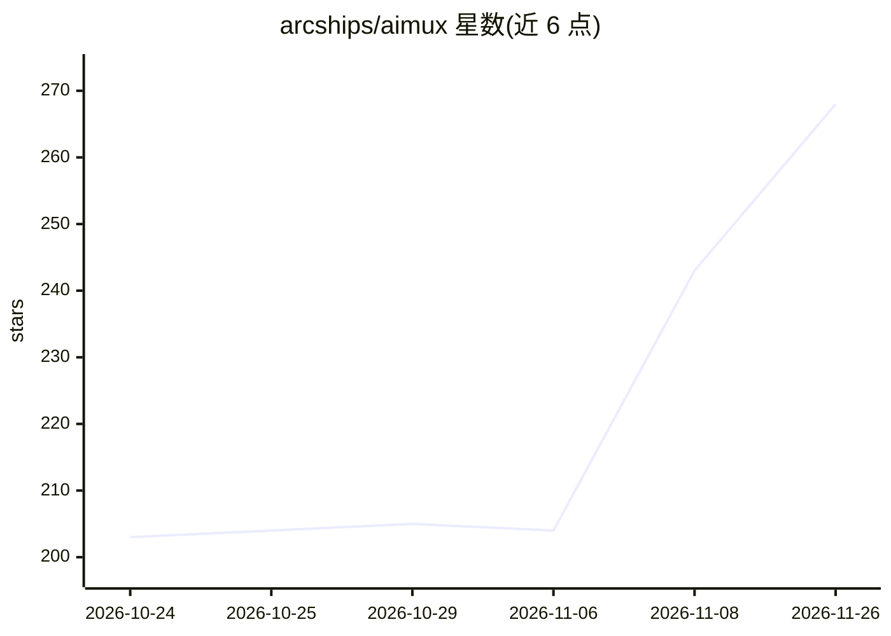

# arcships/aimux

⭐ 268 · Rust · MIT · 推送 2026-11-25 · [GitHub](https://github.com/arcships/aimux) · 个人维护

**给开发者的 Rust 统一 LLM 接入层：一套 API 接入 329 家服务商**

Rust 编写的统一 LLM 服务接入层，把各家 AI 服务商的 HTTP API 收敛到单一 `dyn LanguageModel` 接口。覆盖 329 个 provider 名称（282 个 OpenAI 兼容预设 + 47 个 vendor 包），支持文本、流式、工具调用、嵌入、语音、图像、视频、实时转录等多模态操作；内置 JSONL 录制回放、会话分组与 prompt-cache 命中检测，提供 RouterModel 故障回退与 MoA 聚合组合模型。核心从一份 Rust 代码生成 8 种语言绑定，并附浏览器调试控制台。明确不做 agent 循环、RAG 或编排。0.7 为 breaking release。

## 筛选速览

| 维度 | 判定 | 备注 |
|---|---|---|
| AI 角色 | `ai-ecosystem` | LLM/agent 周边工具 |
| 许可风险 | `permissive` | MIT |
| 部署形态 | `library` | 以包/库形式分发 |
| 模型依赖 | local-ok | 支持本地模型 |
| 硬件要求 | — | 无带数字的原话,不猜 |
| 安装摩擦 | `medium` | 含编译或系统依赖之一 |
| 成熟度 | — | 结构信号不足 |

## 能力要点

- 单一 LanguageModel trait 统一 329 个 provider 名称的接入
- 8 种语言绑定（Node/Python/Swift/Kotlin/Flutter/Go/Java/C）共享同一 Rust 核心
- 请求/响应 JSONL 录制与离线回放，测试无需网络与 API key
- RouterModel 回退路由与 MoA 并行聚合组合模型

## 适用场景

- 在一个项目里统一接入多家 LLM 服务商并随时切换
- 多语言（Go/Java/Swift 等）客户端共享同一套模型调用逻辑
- 离线回放录制流量做回归测试与事故取证
- 带回退策略的路由与 mixture-of-agents 聚合调用

## 场景标签

`模型网关` · 领域:Agent 开发

## 证据(README 行号)

> L24: aimux is a Rust implementation of a unified LLM provider access layer. It
> L28: Unlike **rig** or **langchain**, aimux does **not** build agent loops, RAG, or
> L61: - **8 language bindings** from one core: Node, Python, Swift, Kotlin, Flutter,

## 星数曲线

2026-10-24 203 → 2026-11-26 268（+65）

---
*卡片 v1 · prompt 1.4 · 生成 2026-11-26 · 置信度 high · 依据 README sha `10e856b143a9` · [字段定义](../../DATASET.md)*
