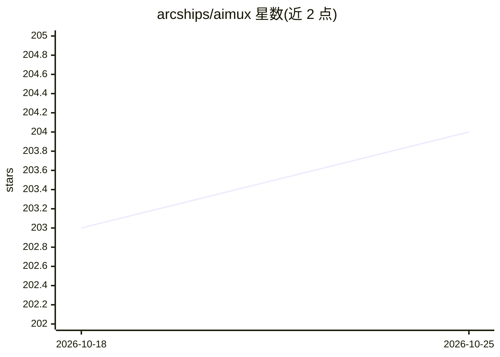

# arcships/aimux

⭐ 204 · Rust · MIT · 推送 2026-10-24 · [GitHub](https://github.com/arcships/aimux) · 组织维护 · 中文 README

**Rust 统一 LLM 接入层：一套 API 访问 327 家服务商**

Rust 实现的统一 LLM 服务商接入层：将各家 HTTP API 归并为单一 dyn LanguageModel 接口，覆盖 327 个 provider 名称（282 个注册表式 OpenAI 兼容预设 + 45 个厂商包，含 Ollama/vLLM 等本地引擎）。支持文本、流式、工具调用、嵌入、图像、语音、转录、视频、重排等多模态，并提供路由回退与 MoA 组合模型、请求录制回放、会话分组、缓存命中追踪。通过 napi-rs/PyO3/C ABI 提供 8 种语言绑定（Node/Python/Swift/Kotlin/Flutter/Go/Java/C）。README 明确不做 agent 循环、RAG 或编排。

## 筛选速览

| 维度 | 判定 | 备注 |
|---|---|---|
| AI 角色 | `ai-ecosystem` | LLM/agent 周边工具 |
| 许可风险 | `permissive` | MIT |
| 部署形态 | `library` | 以包/库形式分发 |
| 模型依赖 | local-ok | 支持本地模型 |
| 硬件要求 | — | 无带数字的原话,不猜 |
| 安装摩擦 | `medium` | 含编译或系统依赖之一 |
| 成熟度 | — | 结构信号不足 |

## 能力要点

- 327 个 provider 名称，统一为可互换的 dyn LanguageModel 接口
- 8 种语言绑定共享同一 Rust 核心（Node/Python 原生，其余走 C ABI）
- RouterModel 路由回退与 MoaModel 聚合（mixture-of-agents 风格）
- 请求/响应录制到 JSONL 并离线回放，2,800+ 磁带测试无需网络与 key

## 适用场景

- 多语言项目中以统一 API 切换不同 LLM 服务商与本地引擎
- 在应用里做 provider 路由回退与多模型聚合
- 离线回放请求做回归测试与事故取证

## 场景标签

`模型网关` · 领域:Agent 开发

## 证据(README 行号)

> L19: aimux is a Rust implementation of a unified LLM provider access layer. It
> L24: orchestration — it focuses exclusively on unifying service access. That is the

## 星数曲线

2026-10-18 203 → 2026-10-25 204（+1）

---
*卡片 v1 · prompt 1.4 · 生成 2026-10-22 · 置信度 high · 依据 README sha `e7eb567ead73` · [字段定义](../../DATASET.md)*
