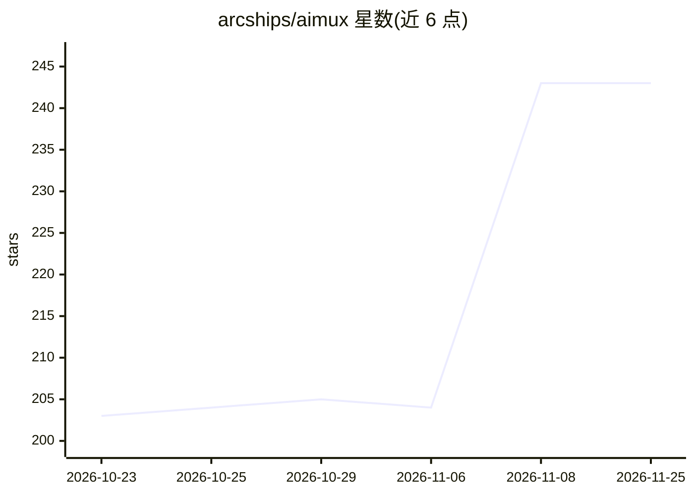

# arcships/aimux

⭐ 243 · Rust · MIT · 推送 2026-11-23 · [GitHub](https://github.com/arcships/aimux) · 个人维护 · 中文 README

**Rust 编写的统一 LLM 接入层：一套 API 调用 327 家服务商**

aimux 将各 AI 服务商的 HTTP API 收敛为单一 LanguageModel trait，提供 282 个 OpenAI-compatible 注册表预设与 45 个厂商包，覆盖文本、流式、工具调用、嵌入、图像、语音、转录、视频、重排序等模态。自带请求录制回放（JSONL）、会话分组、缓存命中追踪、路由回退与 MoA 组合模型；通过 C ABI 提供 Node/Python/Swift/Kotlin/Flutter/Go/Java/C 八种语言绑定，测试基于 2,800+ 回放磁带，无需网络与 API key。明确不做 agent 循环、RAG 或编排。

## 筛选速览

| 维度 | 判定 | 备注 |
|---|---|---|
| AI 角色 | `ai-ecosystem` | LLM/agent 周边工具 |
| 许可风险 | `permissive` | MIT |
| 部署形态 | `library` | 以包/库形式分发 |
| 模型依赖 | local-ok | 支持本地模型 |
| 硬件要求 | — | 无带数字的原话,不猜 |
| 安装摩擦 | `medium` | 含编译或系统依赖之一 |
| 成熟度 | — | 结构信号不足 |

## 能力要点

- 327 个服务商名：282 个 OpenAI-compatible 预设 + 45 个厂商包
- 8 种语言绑定共享同一 Rust 核心（napi-rs/PyO3/C ABI）
- 请求/响应录制为 JSONL 并支持离线回放，测试无需网络与密钥
- RouterModel 带回退路由、MoaModel 并行聚合多个参考模型

## 适用场景

- 在多语言项目中用同一套接口调用不同 LLM 服务商
- 在服务商间切换或做回退路由而不改调用点
- 离线回放真实 API 响应做回归测试与事故取证
- 为Flutter/移动端应用内嵌统一的模型调用能力

## 场景标签

`模型网关` · 领域:Agent 开发

## 证据(README 行号)

> L23: aimux is a Rust implementation of a unified LLM provider access layer. It
> L27: Unlike **rig** or **langchain**, aimux does **not** build agent loops, RAG, or
> L60: - **8 language bindings** from one core: Node, Python, Swift, Kotlin, Flutter,

## 星数曲线

2026-10-23 203 → 2026-11-25 243（+40）

---
*卡片 v1 · prompt 1.4 · 生成 2026-11-25 · 置信度 high · 依据 README sha `1f70457fa506` · [字段定义](../../DATASET.md)*
