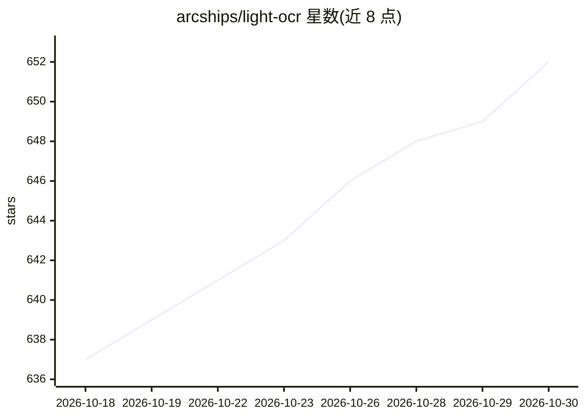

# arcships/light-ocr

⭐ 652 · C++ · Apache-2.0 · 推送 2026-10-08 · [GitHub](https://github.com/arcships/light-ocr) · 组织维护 · 中文 README

**Node.js/C++ 本地离线 OCR 库，识别图片与 PDF 文本**

以 npm 包分发的离线 OCR 库，内置 PP-OCRv6 Small 模型、PDFium 与中文回退字体，读取 JPEG/PNG/PDF/像素缓冲，按阅读顺序返回文本、置信度与四边形坐标。提供 CLI 与 TypeScript/CommonJS/ESM API，附 8 个预编译平台包，无需编译或运行时下载；macOS 15+ Apple Silicon 默认 Core ML，Linux/Windows 默认 WebGPU（Vulkan/D3D12）。C++ 侧从源码构建静态库。限制：预览版 Tiny/Medium 模型需 next 标签，NPU 支持单独安装。

## 筛选速览

| 维度 | 判定 | 备注 |
|---|---|---|
| AI 角色 | `ai-native` | 本体是模型或模型工具 |
| 许可风险 | `permissive` | Apache-2.0 |
| 部署形态 | `library` | 以包/库形式分发 |
| 模型依赖 | — | README 未给出锁定关系 |
| 硬件要求 | — | 无带数字的原话,不猜 |
| 安装摩擦 | `medium` | 含编译或系统依赖之一 |
| 成熟度 | — | 结构信号不足 |

## 能力要点

- npm 单包安装，内置模型、PDFium 与中文回退字体，无二次下载
- 8 个预编译平台，Auto 模式默认启用 Core ML / WebGPU 硬件加速
- CLI 与 Node.js API，识别在主线程外运行，支持队列与取消
- 可选 tiled 模式保留高分辨率图像中的小字文本

## 适用场景

- 在 Node.js 应用、CLI 或桌面软件中做本地 OCR，不上传数据
- 识别含非嵌入中文字体的 PDF 文档
- 为 AI agent 提供确定性 OCR 命令以核验多模态模型输出

## 场景标签

`OCR` · 领域:感知与多模态

## 证据(README 行号)

> L15: **Fast, offline OCR for Node.js and C++.**
> L18: `light-ocr` returns lines in reading order with confidence scores and

## 星数曲线

2026-10-18 637 → 2026-10-30 652（+15）

---
*卡片 v1 · prompt 1.4 · 生成 2026-10-21 · 置信度 high · 依据 README sha `bb814aea1115` · [字段定义](../../DATASET.md)*
