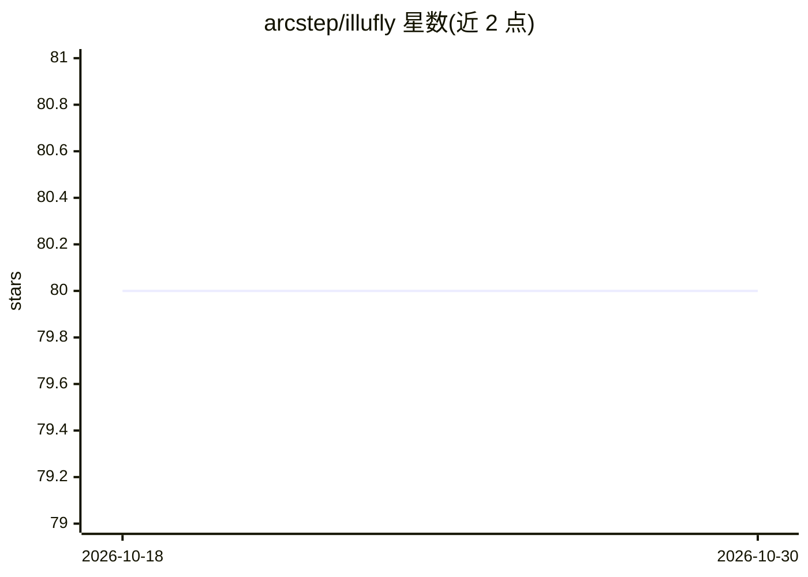

# arcstep/illufly

⭐ 80 · Python · MIT · 推送 2025-12-07 · [GitHub](https://github.com/arcstep/illufly) · [官网](https://github.com/arcstep/illufly/wiki) · 个人维护 · 中文 README

**自我进化 Agent 框架：记忆蒸馏、RAG 与多智能体协作**

Python 实现的 Agent 框架，面向大模型应用开发者。核心特性包括：连续对话与流式输出、内置 RAG（背景知识注入、文档切分+向量检索/Faiss）、对话中自主学习并沉淀经验（ChatLearn，知识去重、冲突检测、FAQ 存储）、OpenAI 工具回调风格的工具调用，以及 ReAct/ReWOO/PlanAndSolve 单智能体和顺序/条件循环的多智能体编排（FlowAgent）。通过环境变量配置 OpenAI 兼容 API。README 自述仍处开发状态，概念会不断更新，建议锁定版本使用。

## 筛选速览

| 维度 | 判定 | 备注 |
|---|---|---|
| AI 角色 | `ai-ecosystem` | LLM/agent 周边工具 |
| 许可风险 | `permissive` | MIT |
| 部署形态 | `library` | 以包/库形式分发 |
| 模型依赖 | — | README 未给出锁定关系 |
| 硬件要求 | — | 无带数字的原话,不猜 |
| 安装摩擦 | `low` | 无编译、无系统依赖或容器化 |
| 成熟度 | `idea` | |

## 能力要点

- ChatLearn 在对话中自主学习知识并存为可召回经验
- 内置 RAG：知识注入与 FaissDB 向量检索两种策略
- 所有 ChatAgent 内置 OpenAI 风格工具回调，普通函数即可作工具
- 内置 ReAct/ReWOO/PlanAndSolve 及多智能体 FlowAgent 编排

## 适用场景

- 构建带记忆和经验积累的对话智能体
- 用 RAG 或对话学习两种方式给 Agent 注入领域知识
- 编排多个智能体完成创作-评审等协作流程

## 场景标签

`Agent 框架` `多智能体` `RAG` `Agent 记忆` · 领域:Agent 开发

## 证据(README 行号)

> L7: **illufly** 是一个具有自我进化能力的 Agent 框架，目标是：`基于自我进化，快速创作价值`。
> L200: illufly 的 ChatAgent 天然具有使用工具的能力，可以直接作为单智能体使用。
> L347: illufly 也内置了多智能体支持方案。

## 星数曲线

2026-10-18 80 → 2026-10-30 80（+0）

---
*卡片 v1 · prompt 1.4 · 生成 2026-10-24 · 置信度 high · 依据 README sha `4a1eaf37a72e` · [字段定义](../../DATASET.md)*
