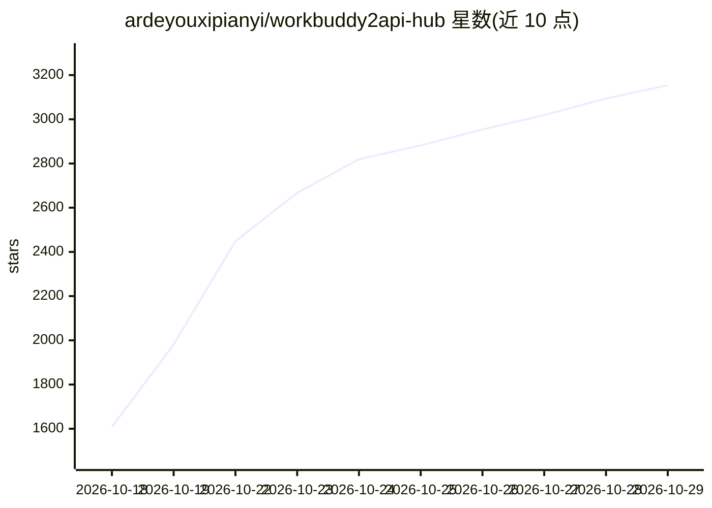

# ardeyouxipianyi/workbuddy2api-hub

⭐ 3,154 · Python · MIT · 推送 2026-10-28 · [GitHub](https://github.com/ardeyouxipianyi/workbuddy2api-hub) · [官网](https://github.com/ardeyouxipianyi/workbuddy2api-intl/releases) · 个人维护 · 中文 README

**腾讯 WorkBuddy 多账号反向代理网关，输出 OpenAI 兼容接口**

把腾讯 workbuddy.ai（国际版）与 codebuddy.cn（国内版）封装成标准 OpenAI 兼容接口（Chat Completions / Responses），并提供默认禁用的实验性 Anthropic Messages 适配。功能覆盖双区域独立路由与调度、多账号 OAuth 接入、设备指纹隔离、每日签到与任务自动化、四条账号级限额护栏、多 API Key 出口绑定、OpenRouter 价格估算、本地网络工具与 7 种 AI 客户端一键配置，配 Web 看板。Windows 绿色包双击即启，另提供 Docker 双架构镜像。

## 筛选速览

| 维度 | 判定 | 备注 |
|---|---|---|
| AI 角色 | `ai-ecosystem` | LLM/agent 周边工具 |
| 许可风险 | `permissive` | MIT |
| 部署形态 | `self-host` | docker 或自建部署 |
| 模型依赖 | — | README 未给出锁定关系 |
| 硬件要求 | — | 无带数字的原话,不猜 |
| 安装摩擦 | `low` | 无编译、无系统依赖或容器化 |
| 成熟度 | `idea` | |

## 能力要点

- 双区域独立路由，Chat Completions / Responses 默认支持，Anthropic Messages 经协议转换且默认禁用
- 设备指纹隔离（derive_id）：按账号 UID 派生稳定机器码，不同账号互不关联
- 四条账号级限额护栏与每日自动化（签到 / 成长任务 / Token 保活）后台调度
- 检测本机 AI 客户端并一键写入 / 还原网关配置（Claude Code / Codex / DSH 等 7 种）

## 适用场景

- 让 Codex / Claude Code / DSH 等客户端通过标准 OpenAI 接口使用 WorkBuddy 账号
- 管理国际版与国内版多账号并按 Key 绑定出口与模型
- 在 NAS 或服务器上以 Docker 部署供局域网客户端共用

## 场景标签

`模型网关` · 领域:Agent 开发

## 证据(README 行号)

> L10: 把腾讯 **www.workbuddy.ai**（国际版）与 **codebuddy.cn**（国内版）的原生服务封装成标准 OpenAI 兼容接口（Chat Completions / Responses），并提供默认关闭的实验
> L14: - **协议与风险**：默认支持 Chat Completions、Responses API（Codex）；Anthropic Messages（Claude Code / Anthropic SDK）经协议转换且缓存兼容性尚未
> L32: **Windows** 双击 **`start-wb-proxy.bat`**，保持窗口运行；**macOS** 双击 **`start-wb-proxy.command`**（首次被 Gatekeeper 拦截时右键 →「打开」

## 星数曲线

2026-10-18 1,608 → 2026-10-29 3,154（+1,546）

---
*卡片 v1 · prompt 1.4 · 生成 2026-10-21 · 置信度 high · 依据 README sha `3ca0d6364d07` · [字段定义](../../DATASET.md)*
