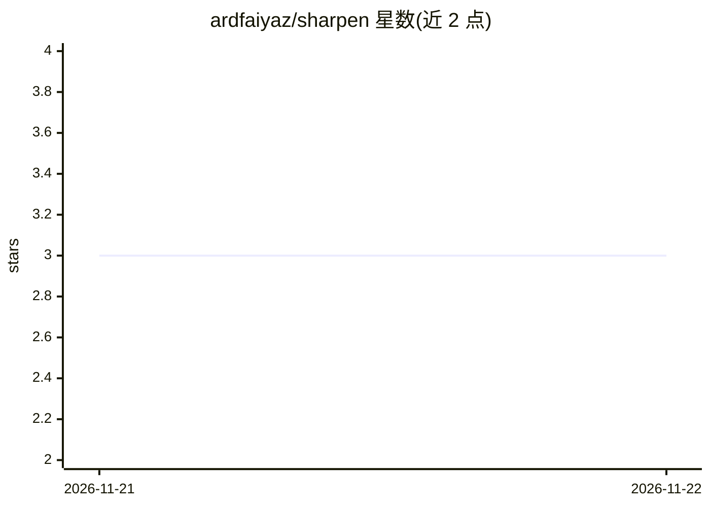

# ardfaiyaz/sharpen

⭐ — · [GitHub]() · 个人维护

**Claude Code 插件：把模糊提示改写为结构化任务提示**

以 Claude Code 插件形式分发，读取用户输入的简短提示，结合当前会话、代码库检索以及已安装的 skills、agents、MCP 工具与 hooks，将其改写为包含位置、约束、工具与验收标准的工程化提示，经审查卡片确认后才执行。含分类门控（清晰/补全/歧义三档）、歧义时的选项询问、剪贴板复制，以及十个配套技能（改写、审计、交接、拆分、规划等）。零依赖、无遥测、无 API 调用；需 Claude Code 与 Node.js 18+，默认关闭。

## 筛选速览

| 维度 | 判定 | 备注 |
|---|---|---|
| AI 角色 | `ai-ecosystem` | LLM/agent 周边工具 |
| 许可风险 | `permissive` | — |
| 部署形态 | `None` |  |
| 模型依赖 | — | README 未给出锁定关系 |
| 硬件要求 | — | 无带数字的原话,不猜 |
| 安装摩擦 | `low` | 无编译、无系统依赖或容器化 |
| 成熟度 | — | 结构信号不足 |

## 能力要点

- 基于会话、代码与已安装 skills/agents/MCP/hooks 生成工程化提示
- 审查卡片三选一：发送改写版/按原文运行/自行修改，先复制到剪贴板
- 仅当两种解读导向不同工作时才询问用户意图
- 十个配套技能：审计、交接、拆分、分阶段规划、提示教练等

## 适用场景

- 输入简短描述前先让插件补全文件、测试与工具上下文
- 歧义任务（如多个登录 bug）时让插件列出候选解读
- 把长会话交接给新会话或拆分为可并行的小任务

## 场景标签

`提示工程` · 领域:Agent 开发

## 证据(README 行号)

> L17:  A Claude Code plugin that rewrites your plain prompt into the prompt you meant, using your conversation, your code
> L38: **Requires** Claude Code with plugin support, and Node.js 18 or later, which runs the hooks.
> L119: **2. Gather, fast.** It checks the conversation first, then does a few quick searches of the code: at most 3, or 6

## 星数曲线

2026-11-21 3 → 2026-11-22 3（+0）

---
*卡片 v1 · prompt 1.4 · 生成 2026-11-22 · 置信度 high · 依据 README sha `041f48da6d78` · [字段定义](../../DATASET.md)*
