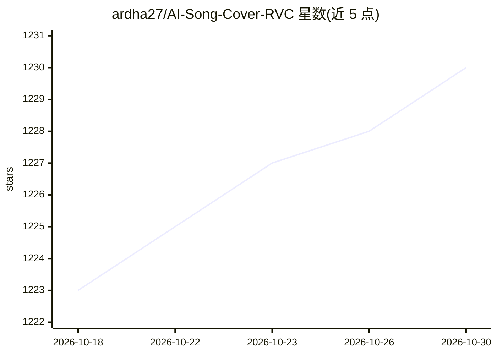

# ardha27/AI-Song-Cover-RVC

⭐ 1,230 · Jupyter Notebook · MIT · 推送 2026-05-31 · [GitHub](https://github.com/ardha27/AI-Song-Cover-RVC) · [官网](https://ko-fi.com/ardhach) · 个人维护

**在 Colab/Kaggle 上制作 RVC 歌曲翻唱的一体化工具包**

面向个人用户的一体化 RVC 歌曲翻唱工具包，以 Colab/Kaggle notebook 形式提供：从 YouTube 下载音频并转为 WAV、人声分离、音频切分、模型训练与推理。包含无 Gradio 界面的防封禁训练路径（Colab 免费版可用）、AICoverGen 推理 notebook（含 Colab Pro 专用版本），并提供印尼语视频教程。整体流程在云端 notebook 中运行，无需本地安装。

## 筛选速览

| 维度 | 判定 | 备注 |
|---|---|---|
| AI 角色 | `ai-native` | 本体是模型或模型工具 |
| 许可风险 | `permissive` | MIT |
| 部署形态 | `None` |  |
| 模型依赖 | — | README 未给出锁定关系 |
| 硬件要求 | — | 无带数字的原话,不猜 |
| 安装摩擦 | `low` | 无编译、无系统依赖或容器化 |
| 成熟度 | — | 结构信号不足 |

## 能力要点

- YouTube 音频下载为 WAV 与人声分离、切分一体化流程
- 提供无 UI 训练路径以降低 Colab 免费版封禁风险
- 训练与推理 notebook 覆盖 Colab 免费版与 Pro 版

## 适用场景

- 用喜欢的歌手声音制作 AI 歌曲翻唱
- 在 Colab 上训练自己的 RVC 语音模型
- 从 YouTube 音源直接下载并分离人声进行训练

## 场景标签

`语音合成` · 领域:内容生成

## 证据(README 行号)

> L2: Everything you need for RVC voice covers in one place, run on Google Colab or Kaggle: download YouTube audio as WAV,
> L18: ## Training Without UI/Gradio, Prevent Banning (Colab Free)

## 星数曲线

2026-10-18 1,223 → 2026-10-30 1,230（+7）

---
*卡片 v1 · prompt 1.4 · 生成 2026-10-21 · 置信度 high · 依据 README sha `0eeaf52ade63` · [字段定义](../../DATASET.md)*
