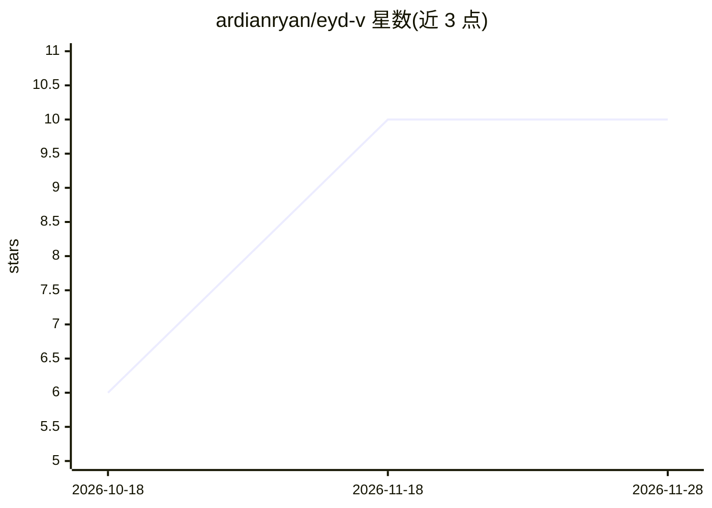

# ardianryan/eyd-v

⭐ 10 · JavaScript · MIT · 推送 2026-11-09 · [GitHub](https://github.com/ardianryan/eyd-v) · [官网](https://ejaan.kemendikdasmen.go.id) · 个人维护

**面向 AI Agent 与开发者的印尼语正字法（EYD V）规则、数据集与 linter 工具集**

社区开源项目，基于印尼官方 EYD 第五版拼写规范整理为结构化数据集与 AI Agent 技能（SKILL.md），并提供无外部依赖的 npm linter。功能覆盖文本检查、KBBI 标准词查询、6 个专业写作域模式（UX/营销/SEO/学术/法律/金融）、字幕文件检查、MCP Server、REST API、Docker/Cloudflare 部署、Git hook、VS Code/Cursor 扩展，以及 SFT/DPO/RAG 评测数据集。声明为独立社区项目而非 Kemendikdasmen 官方仓库。

## 筛选速览

| 维度 | 判定 | 备注 |
|---|---|---|
| AI 角色 | `ai-knowledge` | 知识聚合/清单类 |
| 许可风险 | `permissive` | MIT |
| 部署形态 | `self-host` | docker 或自建部署 |
| 模型依赖 | local-ok | 支持本地模型 |
| 硬件要求 | — | 无带数字的原话,不猜 |
| 安装摩擦 | `low` | 无编译、无系统依赖或容器化 |
| 成熟度 | — | 结构信号不足 |

## 能力要点

- 基于印尼官方 EYD 第五版规范，38 个菜单、4 大章节的结构化规则数据
- 内置 MCP Server（check_spelling/search_eyd 等工具）与通用 Agent Skill
- 6 个专业写作域模式与 AI 反陈词滥调检查规则
- SFT(ChatML/Alpaca)、DPO、RAG 评测等多格式训练数据集

## 适用场景

- 为 AI IDE 或编码 Agent 安装印尼语正字法规则
- 对印尼语文档/字幕做自动化拼写与规范检查
- 获取印尼语 SFT/DPO/RAG 评测数据集用于模型训练
- 查询官方术语对应词（如 prompt engineering → rekayasa prompt）

## 场景标签

`模型评测` · 领域:评测与运维

## 证据(README 行号)

> L7:  Universal AI Agent Skill, Domain-Specific Writing Engine, Dataset Terstruktur & Linter Ekosistem Berbasis EYD Edisi
> L44: * 🤖 **Universal Agent Skill (`SKILL.md`) & Sub-Skills**: Siap dipasang ke Google Antigravity, Claude Code, Cursor I
> L45: * ⚡ **Model Context Protocol (MCP Server)**: Dilengkapi server MCP bawaan (`npx eyd-v mcp`) dengan tool `check_spel

## 星数曲线

2026-10-18 6 → 2026-11-28 10（+4）

---
*卡片 v1 · prompt 1.4 · 生成 2026-11-20 · 置信度 high · 依据 README sha `b72b061867e5` · [字段定义](../../DATASET.md)*
